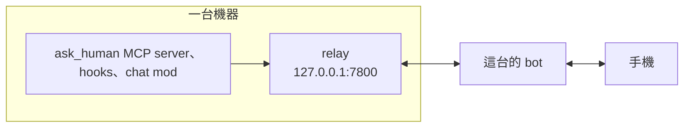
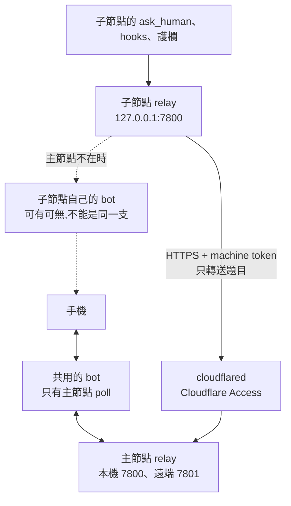

# Async Human-Gate Bridge — SPEC (v3, 定稿)

> **Status:** 已實作並持續修訂(目前 v0.20.3;各版內容見下方各節的「後續修訂」;多機共用 relay 的協定見 §5.1)
> **Type:** Flow tooling(AI agent 工作流程的基礎建設)
> **Home:** 獨立 repo(Claude Code plugin「myna」)。

**One-liner:** 讓 AI agent 工作流程的 human gate 以「帶按鈕的 IM 傳到手機、一點就回、flow 原地接續」的方式非同步進行,支援**選了自由填寫後的多輪釐清問答全程在 Telegram 上跑**,且**跨多台機器、多組 Claude 帳號匯進單一手機收件匣**。

---

## 版本沿革

- **v1:** 單次問答 blocking tool 的初版構想。
- **v2:** gate 從「單次問答」改成「對話迴圈」(discriminated result + `thread_id` + `preamble`);自由填寫 UX 定為專用按鈕 + `force_reply`。
- **v3(本版,定稿):** 鎖定全部 §8 決策;callback_data 用 `token→state` 反查(解 64-byte 限制 + 按鈕文字截斷);因 **4(b) 無限等** 移除 timeout 語意、新增 `aborted` result + 手機 Abort 鈕 + relay nudge scheduler;落腳改 **獨立 repo(7b)**。

---

## 1. Problem / 動機

`/feature`、`/batch` 的四個 human gate(① AC+architecture、② space-time tradeoff、③ review DECISION、④ eyeball)目前卡在**終端機前的 `AskUserQuestion` picker**,人不在座位 flow 就停。

Remote Control 不合用:它把 session 綁在**當下登入的帳號**,多台機器 × 多組帳號 → 手機上是分散、各自為政的 session 列表,無統一收件匣。**自寫方案的價值 = 路由由我們掌握 → 全部 gate 匯進同一支 bot / 同一支手機。**

## 2. Goals / Non-goals

**Goals**
- **G1** gate 問題(header + question + options)推到手機,**點按鈕即回**,答案回傳讓 flow **原地接續**。
- **G2** 選「自由填寫」後的**多輪釐清問答,全程在同一 Telegram thread**,直到定案。
- **G3** **跨機器 / 跨帳號統一收件匣**,每則帶 `[機器 / ticket / gate 類型]` 標籤。
- **G4** 純 MCP tool 機制 → 繞過 channel research-preview 的 org gating;**headless `claude -p` 也適用**(無人值守整條 pipeline)。
- **G5** relay 不可達 → **安全退回**本機 `AskUserQuestion`;無限等期間可從手機 **Abort** 乾淨中止 run。絕不 hang、絕不誤答。

**Non-goals**
- 不攔截 built-in `AskUserQuestion` UI(攔不到);做法是在 gate **改呼叫我們的 tool**。
  - **後續修訂(2026-07):** 部分成立——hook 仍**不能代替 tool 回傳答案**,但 `PreToolUse` hook 可以 **deny `AskUserQuestion` 並把「改呼叫 `ask_human` 的清單」回饋給模型**,達到等價的「轉手機」效果(多一次 round-trip)。用途:workflow 以外、模型自發的 `AskUserQuestion` 也能上手機。見 `scripts/intercept-ask.mjs` + `/myna:intercept`(flag `~/.myna/intercept`,**預設開**,首行 `off` 才關;relay 不可達則放行退回本機 gate,故未設定環境等同無作用)。
  - **gate-brief(`/myna:brief`,預設開):** 攔截時另請模型產一份「決策輔助」——問題與**每個選項**的 context(`context`/`detail`/`pros`/`cons`/`when_to_pick`/`risks`+選配欄位),由 `scripts/render-gate.mjs` 渲成 self-contained HTML、經 Artifact 發布(每 session 一條滾動 URL、多題同頁),URL 放進第一個 `ask_human` 的 `preamble`。因深度都在 artifact,Telegram 的問題/選項文字精簡。artifact 單向展示,作答仍走 Telegram;發不出 artifact 則自動跳過、照樣送 Telegram。
    - **後續修訂(2026-09,Mermaid 流程圖,v0.9.0):** brief JSON 新增選填 `diagram`(Mermaid 原始碼字串)——頂層 = 整頁總覽(標題列下方),每題 = 該題 `context` 之後。只有非空字串才算;缺欄位/空字串/其他型別輸出與舊版完全相同(**無圖頁不帶任何 script**)。原始碼以 HTML 跳脫(`& < > " '`)放進 `<pre class="mermaid" data-src>`,JS 未執行時即可讀、敵意內容永不成為 live markup;有圖時才附一個 `<script type="module">`,動態 import jsDelivr 的 `mermaid@11` ESM(Artifact allowlist),`initialize({startOnLoad:false, securityLevel:'strict', theme: dark|default, suppressErrorRendering:true})`,**逐張** `mermaid.render` 各自 try/catch(一張壞圖不影響其他),依 `prefers-color-scheme` / `data-theme` 變化從 `data-src` 重畫。解析/渲染失敗或 CDN import 失敗 → 該區塊顯示 fallback(「圖表無法渲染，以下為 Mermaid 原始碼」+ 錯誤訊息 + `<pre><code>` 原始碼)。版面:圖框 `overflow-x:auto`、SVG `max-width:100%; height:auto`,375px 手機寬整頁不橫捲。hook 的 STEP 1 指示告知模型此欄位與撰寫原則(`flowchart TD`、≤15 節點、決策標在發生的那一步、圖補充文字而非取代)。
- v1 不做 Teams(M365 Adaptive Card + Azure bot 設定重)——列後續。
- 不取代 gate ④ 的「實體尺度 / 手感」人到機器前的最終判斷;v1 把**截圖 + 標好 priority 的 look-point 清單**送到手機供**核准 / 退回**。

## 3. 架構

**每台機器一個 relay(實作至今都是這樣):** relay 只聽本機的 `127.0.0.1:7800`(`src/relay.mjs:97`、`:1152`),同一台的 `ask_human` MCP server、hooks、護欄、chat mod 都只跟自己這台的 relay 說話;每個 relay 擁有自己的 bot 連線(`src/providers/telegram.mjs:2`,getUpdates long-poll),綁一個配對過的聊天室(`:57`、`:68`)。一支 bot 同時只能由一個 relay poll。



多台機器在 0.20 以前,就是每台各跑一個 relay、各用自己的一支 bot,手機上收到好幾支 bot 的訊息。v3 的構想(多台機器的 MCP server 都連到同一個 relay)沒有照字面實作:relay 只聽本機,別台連不到。

**後續修訂(2026-11,多機共用 relay,v0.20.0):** 多台共用一支 bot 實作成「主節點 + 轉送模式」,client 端一行都不用改:



- 主節點(`MYNA_ROLE` 沒設或 `hub`):本機 listener `127.0.0.1:7800`(同 0.19,不需要 credential;擋瀏覽器與非 loopback Host,多機時再擋代理標頭);遠端 listener `127.0.0.1:7801`(`MYNA_REMOTE_PORT`,每個請求都要 machine token,`src/relay.mjs:1170`),前面接 cloudflared 和 Cloudflare Access。
- 子節點(`MYNA_ROLE=edge`,同一個 `src/relay.mjs`):主節點正常 → 轉送到主節點;主節點不在 → 新題目改發自己的 bot(沒有就退回終端機)。自己的 bot 跟主節點那支相同時不用,只轉送(`src/relay.mjs:509-515`)。`ask_human`、hooks、護欄照樣打 `127.0.0.1:7800`。

協定、驗證與相容規則見 §5.1。

**元件**
- **`ask_human` MCP server**(每台機器一份,`.mcp.json` 註冊,**Node/Bun**):expose 一個**阻塞式** tool;被呼叫 → 送問題到 relay → 掛住等回覆(heartbeat 保活)→ 回傳「選項」或「人傳來的訊息」或「abort」。
- **Relay**(單一自架常駐服務,Node/Bun):獨佔那支 Telegram bot 的連線(解「一支 bot 只能一個 process long-poll」),維護三張表:`request_id → 機器的 pending long-poll`、`thread_id → Telegram 對話串`、`token → {request_id, optIndex}`(callback 反查)。做機器↔手機 fan-in/fan-out + nudge scheduler。
- **Telegram bot**:選項以**編號列在內文**、按鈕做成精簡 `[1][2][3][✍️][⏹]`;點按 → callback(帶短 token);`force_reply` 收自由文字。

**一次 gate 的生命週期(含對話迴圈)**
1. flow 在 gate 呼叫 `ask_human({header, question, options, multiSelect})`。
2. MCP server 產 unguessable `request_id` + 新 `thread_id`,帶 `{machine, account, ticket}` **POST /ask** 到 relay,然後 **GET /answer/{request_id} long-poll**(無限等 + heartbeat)。
3. relay 為每個選項配一個短 token(存 `token→{request_id,optIndex}`),用 bot 送「編號內文 + 精簡按鈕 + ✍️ + ⏹」到手機;啟動該 request 的 nudge 計時。
4a. **你點具體選項** → callback 帶 token → relay 反查 → 回 `{kind:"selection", value}` → tool return → **gate 結束,flow 接續**。
4b. **你點 ✍️ 打字(反問/釐清)** → `force_reply` 收文字 → relay 回 `{kind:"message", text}` → tool return → **orchestrator 讀訊息、回應它、帶同一 `thread_id` 再呼叫 `ask_human`(回覆放 `preamble`)** → 回步驟 3,在**同一 Telegram thread** 續問。
4c. **你點 ⏹ Abort** → relay 回 `{kind:"aborted"}` → tool return → **orchestrator 乾淨中止該 run**。
5. 迴圈到 `selection` 或 `aborted`。

## 4. `ask_human` tool 合約

**Input**(對齊 `AskUserQuestion` 語意 + 對話續接欄位):
```jsonc
{ "header": "space-time",                 // 短 chip 標籤
  "question": "…要包含 X 嗎?",
  "options": ["A(Recommended)", "B", "C"], // 可為 [] → 退化成純文字對話 turn
  "multiSelect": false,
  "thread_id": "gate-PROJ123-②",             // 第一輪省略;續問帶回同一個 → 同一串對話
  "preamble": "好問題——A 確實涵蓋 X,因為…",  // 模型對你上一則訊息的回覆,顯示在問題上方
  "images": ["…/eyeball-…png"] }           // 選配(gate ④ 截圖)
```

**Output(discriminated result):**
```jsonc
{ "kind": "selection", "value": "A" }              // 點了具體選項 → 終結
{ "kind": "selection", "value": ["A","C"] }        // multiSelect 按 Done
{ "kind": "message",   "text": "A 有涵蓋 X 嗎?" }   // 點 ✍️ 打字 → 尚未終結,交由 orchestrator 續問
{ "kind": "aborted" }                              // 手機按 ⏹ → orchestrator 中止 run
{ "kind": "unreachable" }                          // relay/bot 不可達 → fallback 本機 gate
```
> 注意:**決策 4(b) 無限等** → **沒有 `timeout` result**。relay 可達就無限等(+nudge);唯一的離場是使用者作答 / Abort,或 relay 不可達。

**行為**
- 阻塞直到回覆到;server 端 **heartbeat 保活**;**每一輪(每次 tool call)獨立管理連線**。
- **✅ 命脈假設 VERIFIED(2026-07,Spike A′):單一 MCP tool call 撐得住長等。** headless `claude -p` 下阻塞 5 分鐘未被砍,回傳 tool 值、`CLAUDE_EXIT=0`。設定:`.mcp.json` per-server `"timeout": 86400000`(24h)+ `CLAUDE_CODE_MCP_TOOL_IDLE_TIMEOUT=0` + 每 15s heartbeat。**不需要 poll-版分岔。**(poll 版備案仍記於 §13,若未來遇到硬上限再啟用。)

## 5. Relay 合約(草案)

- **`POST /ask`** `{request_id, thread_id, machine, account, ticket, header, question, options, multiSelect, images?}` → 202。
- **`GET /answer/{request_id}`**(HTTP long-poll,決策 3a)或 heartbeat 保活 → `{kind, value|text}`。
- **thread 續接:** 依 `thread_id` 把後續訊息 `reply_to` 掛同一 Telegram 串;首見則開新串。
- **token 反查(解 callback_data 64-byte + 按鈕截斷):** callback_data = 短 opaque `token`(或 `token.optIndex`,約 10–16 bytes);完整狀態存 server 端 `token→{request_id, optIndex}`。選項**全文列在訊息內文**、按鈕只放編號。
- **nudge scheduler(決策 4b 必需):** request pending 期間每 N 分鐘回同一 thread 補「仍在等 PROJ-123 gate②」。
- **Telegram 事件:** 按鈕 callback → 反查 token → `selection`/`aborted`;✍️ → `force_reply` → `message`。
- **安全:** `request_id`/`token` 皆 unguessable random;**只有 allowlisted chat_id** 能回;`selection` 侷限於呈現過的 options;`message` 文字信任等級 = 終端機作答;每台機器以 **per-machine token** 對 relay 認證,答案只回發問那台(v0.20.0 起實作,見 §5.1)。
- **後續修訂(2026-10,session 交接 detach / reattach,v0.10.0):** 發問端結束時原本一律取消自己還在等的題目(`POST /cancel/<id>`),要換 session 接手就只能取消後重問,人會看到同一題被收回又重送。現在一個 session 可以把等待中的題目**交出**,另一個 session **接回**,手機上的訊息、按鈕、topic 都不變。設計是通用的「session A 交出、session B 接回」,不假設呼叫端是誰;request id 怎麼交給接手方由呼叫端自己決定,Myna 只提供取得與接回的方法。
  - **MCP tool:** `detach_human({request_id?})` 交出本程序等待中的題目(預設全部):relay 標記為已交出,本程序正在等的 `ask_human` 呼叫立刻回 `{kind:"detached", request_id}`,題目移出程序結束時要取消的名單;回傳每題的 `{request_id, gate, thread_id, header, question, options, until}`。`await_human({request_id?})` 接回並阻塞等答案,回傳格式同 `ask_human`;不帶 id 時列出同一個 session id 下沒有程序在等的題目(一題就接回,沒有回 `{kind:"none"}`,多題回 `{kind:"choose"}`)。
  - **Relay:** `POST /detach/<id> {session_id}`(只有發問的 session 能交出,否則 403)、`POST /reattach/<id> {session_id, session_name}`、`GET /requests?session_id=`。交出後 `/answer` 對該題一律回 `{kind:"detached"}`、不交付答案(舊 owner 正在等的輪詢會被立刻叫醒),答案留給接回的 session;已交出且已答的答案不受 300 秒未取走清理影響。交出狀態(與 `/ask` 時的 `gate`/`thread_id`/題目/選項)寫進 journal,relay 重啟後照樣接回、期限照算。
  - **權限:** 接回需要 `request_id`,且只能接回**已交出**的題目;例外是同一個 session id 自己的題目、且已沒有程序在輪詢(最後一次 `/answer` 結束超過 `MYNA_ATTENDED_GRACE_MS`,預設 15 秒)——這是程序 crash 後用同一個 session id 重新連上(例如 `claude --resume`)的情境。**現況確認:** 修正前,這種情況下舊程序來不及取消,題目會一直留在 relay、按鈕有效,但新程序拿不到 request id、接不回來,題目也沒有期限,變成沒人收的孤兒。同 session 的另一個程序還在等時回 409。
  - **topic 歸屬:** 接回時題目改歸接手的 session,所在的 topic 一起轉移(Telegram `transferRequest`):那是舊 session 目前的 topic → 整筆對照(含 stale)轉給新 session,新 session 已有 topic 時併入它的 stale;那是 stale topic → 只轉那一個。所以接手後同一個 gate 的追問會留在同一個 topic,舊 session 的 `/session/close`、round-end 也不會再碰它。舊 session 若在接回前就結束,`/session/close` 依原有規則延後(它還有題目沒答),接回後隨即執行(此時已沒有 topic 要收)。
  - **期限 `MYNA_DETACH_TTL`(秒,預設 1800):** 交出後期限內沒人接回 → 照一般結束的規則處理:未答的題目取消(收回按鈕、註明「交出後沒有 session 接手」),已答未取走的答案丟掉,延後的 topic 收尾接著執行。**為什麼是 30 分鐘:** 要涵蓋交出到接回的空檔——計畫性交接 <1 分鐘、session 當掉由外部監控程式重開最壞約 10 分鐘、人手動重開幾分鐘到十幾分鐘。太短會在交接完成前就過期,丟掉人已經作答的答案;太長會讓沒人收的按鈕一直留在手機上。30 分鐘是「當掉重開」最壞情況的 3 倍餘裕,可用 `MYNA_DETACH_TTL` 調。
  - **相容:** 沒有交出的題目行為不變(程序結束、`/session/close`、在終端機作答照舊取消)。Discord / Slack 沒有 topic 與收回按鈕的實作,交接本身(交出、接回、期限)照樣運作。Stop hook 判斷「最後一次問人」時把 `await_human` 也算進去。
- **後續修訂(2026-10,核准作證 `approves` + `POST /attest`,v0.19.0):** 使用者自己的護欄(例如 PreToolUse hook)會攔下對外或收不回的動作(push 到 main、merge PR…),人透過 `ask_human` 按 ✅ 核准後,護欄要放行**那一個指令、而且只放行一次**。原本護欄讀專案裡的 `MYNA-DECISIONS.jsonl` 判斷,但這個檔案 agent 自己就寫得到,等於可以偽造核准;護欄也因此綁死 myna 內部的檔案格式。改成向 relay 求證:核准紀錄只能從 IM 按鈕的 callback 產生,護欄只依賴一個窄而通用的 HTTP API。
  - **`ask_human` 新增選填 `approves`(字串):** 核准後要執行的那一行完整指令。非空字串、長度上限 2000;有 `approves` 時,選項裡至少要有一個以「✅」開頭(核准用的選項),否則人按什麼都核准不了。不符合 → validation error,什麼都不送(MCP server 的 `validateAskArgs` 擋一次,relay 的 `/ask` 再擋一次)。手機上在選項之後多一行「核准後執行：<指令>」,指令**原文顯示**:Telegram 不經過 `mdToPlain`(不用 `parse_mode`,本來就是純文字),Slack 是 `plain_text`,Discord 會把內文當 markdown,所以 markdown 字元以反斜線跳脫,畫面上看到的仍是原文。`approves` 跟著 `/ask` 一起送給 relay。relay 把正規化後的指令放在該題**只存在記憶體**的欄位,記錄 approval 時只看這個欄位;該題的 meta 也會留一份原文(journal、`/requests`、`detach_human` 的回傳看得到),但**只供參考,不會拿來記 approval**。**autopilot 不核准:** 帶 `approves` 的題目在 autopilot 下照樣送去問人(自動接受的答案不會在 relay 留下核准,護欄也就不會放行,與其讓 AI 拿到一個沒用的 ✅,不如直接問人)。
  - **relay 記錄 approval:** 帶 `approves` 的題目,只有**人從 IM 按下按鈕**(provider 的 callback,`resolveFromIM`)、而且選的選項以「✅」開頭時,才記一筆 `{request_id, session_id, command, chosen, answered_at}`。relay 自己產生的結果(`/cancel` = 終端機作答 / Esc、程序結束、交出過期、孤兒清理、送不出去的 unreachable)直接走 `resolveRequest`,不會記;✍️ 文字回覆(即使內容是「✅ …」)、⏹、選了沒有 ✅ 的選項也不記。`session_id` 是作答當下該題所屬的 session(交出後被接回的題目,屬於接回的 session)。**只有這個 relay 程序自己收到 `/ask` 的題目**才會記:relay 重啟前發出、從 journal 接回的題目,重啟後才按 ✅ 也照樣回答 AI(`{kind:"selection"}`),但**不記 approval**,要再問一次。
  - **指令正規化:** 記錄與比對時都只做兩件事:去掉頭尾空白,把連續的空格與 tab 壓成一個空格。**換行不壓**:shell 裡換行是指令分隔,`echo ok\nrm -rf x` 與 `echo ok rm -rf x` 是不同的指令。
  - **`POST /attest {command, session_id}`:** 找一筆同 session、指令正規化後完全相同、還沒用過、`now - answered_at <= MYNA_APPROVAL_TTL_MS`(毫秒,預設 900000 = 15 分鐘,`.env` 可設)的 approval;有好幾筆時用最舊的(最先過期的)。找到就**當場標成已用**(`used_at`,記憶體裡),回 `200 {approved:true, request_id, answered_at, chosen}`。其他情況一律 `approved:false`:`200 {approved:false, reason}`,`reason` 是 `no_approval`(沒有符合的,relay 重啟後也是這個)/ `already_used` / `expired`;body 不對時是 `400 {approved:false, reason}`(`bad_json` / `command_required` / `session_id_required`)。呼叫端只要看 `approved === true`,其他一律視為沒核准(連不上 relay 也是)。**一次性:** 讀完 body 之後「找 + 標記」都在同一個同步區段,relay 是單一程序,兩個同時進來的 attest 只有一個拿到 true。`/health` 多回 `attest: true` 與 `approval_ttl_ms`,呼叫端可以藉此確認 relay 支援。
  - **不持久化(只放在 relay 的記憶體):** approvals(包括「已經用過」的標記)**不寫進 journal,也不從 journal 讀回來**。原因:journal(`~/.myna/relay-pending.json`)跟 `MYNA-DECISIONS.jsonl` 一樣是 agent 寫得到的檔案,relay 啟動時從裡面讀回來的任何 approval 都可能是 agent 寫進去的——停掉 relay、塞一筆假的、再啟動,就等於偽造核准(最初的實作就有這個漏洞,是自動安全審查抓到的)。同樣的理由,從 journal 接回的題目也不記 approval(否則改掉 journal 裡那題的 `approves`,人在手機上看到的是 A 指令,按下 ✅ 卻核准了 B)。journal 裡有 `approves` 欄位(舊格式或被放進去的)時,relay 照常啟動,只在 log 記一行「忽略」,下一次寫 journal 時就消失。**代價:** relay 重啟或升版後,所有核准都消失,attest 一律回 `no_approval`,要人重新按 ✅(重啟前還沒答的題目,重啟後按 ✅ 也一樣不算,AI 要再問一次)。relay 很少重啟,核准又只有 15 分鐘,這個代價可以接受。「已經用過」的標記也跟著消失,但被標記的 approval 本身也一起消失,不會因此被重用。清理:每分鐘把超過 TTL 的 approval 從記憶體刪掉(用過或沒用過都一樣)。
  - **`MYNA-DECISIONS.jsonl` 加 `answered_at`:** MCP server 實際拿到答案的時間(`ask_human` / `await_human`;autopilot 是自動接受的時間)。原本的 `ts`(發問時間)不變,維持相容。帶 `approves` 的題目也把 `approves` 記進去。這個檔案仍然只是**稽核紀錄**,不是核准的依據。
  - **安全模型與極限:** 這個 API 把「偽造核准」的門檻從「寫一行 JSON 到專案目錄」拉高到「要動到 relay 本身」,**不是絕對的隔離**。relay 跟 agent 用同一個 OS 帳號執行,所以 agent 理論上仍然可以:停掉 relay、自己在 :7800 起一個永遠回 `approved:true` 的假 relay;讀 `~/.myna/.env` 偷 bot token,自己呼叫 Telegram API、冒充 bot。改 journal 這條路已經關掉(見上面「不持久化」)。護欄能做的是把這些路徑本身也擋下(例如不准動 relay 的程序與 `~/.myna`),並把每次 attest 記下來。要完全隔離,需要讓 relay 用**不同的 OS 帳號**執行(agent 讀不到它的檔案、也停不掉它),或把 bot token 與簽章金鑰放進 Keychain 並設定存取限制、approval 改成 relay 簽章;這些**不在這次範圍**。另外,`/attest` 沒有驗證呼叫者:任何本機程序都能用掉一筆 approval(只會讓核准失效,不會多放行)。
  - **相容:** 不帶 `approves` 的題目行為完全不變;journal 格式沒有新增欄位,新舊版 relay 互相接回 journal 都沒問題(換版本 = relay 重啟 = 核准消失,護欄拒絕,偏向安全)。Discord / Slack 一樣會記 approval(按鈕 callback 同樣走 `resolveFromIM`)。
- **後續修訂(2026-10,approves 加固:只能有一個 ✅ 選項、拒絕看不見的字元,v0.19.2):** 自動安全審查對 v0.19.0 的 `approves` 提出兩個問題。(1) `validateAskArgs` 只要「至少一個」選項以 ✅ 開頭就接受,有「✅ 執行」和「✅ 先不要」兩個時,人按哪一個都算核准。(2) `approves` 含雙向文字控制字元(U+202E 等)或零寬字元(U+200B、U+FEFF 等)時,手機上「核准後執行：」那一行看起來跟實際執行的指令不一樣。
  - **剛好一個 ✅ 選項:** 帶 `approves` 時,以「✅」開頭的選項必須剛好一個,沒有或兩個以上都是 validation error(MCP server 的 `validateAskArgs` 擋一次,relay 的 `/ask` 用同一個函式再擋一次,回 400)。`/ask` 時把那唯一的 ✅ 選項記在該題只存在記憶體的 `approveOption`(跟 `approves` 一樣不寫進 journal);`resolveFromIM` 記 approval 時除了「選項以 ✅ 開頭」,還要求選中的就是 `approveOption`。正常路徑上 `/ask` 已經擋掉多個 ✅,這是多一層防護。
  - **拒絕看不見的字元:** `approves` 含下列任一字元就是 validation error(MCP server 和 relay 的 `/ask` 都擋):C0 控制字元(`\n` 除外;tab 也拒絕,手機上看不出 tab;`\r` 也拒絕)、U+007F-U+009F、U+200B-U+200F、U+202A-U+202E、U+2060-U+2069、U+FEFF;另外也拒絕同樣看不見的 U+00AD(軟連字號)、U+061C、U+180E、U+2028-U+2029、U+E0000-U+E007F(tag 字元)。錯誤訊息寫出是哪個字元(`U+202E`)和位置。範圍寫成 code point 表(`APPROVES_HIDDEN_RANGES` + `hiddenCharIn`),原始碼裡不放這些字元本身。多行指令(`\n`)照樣接受,手機上照原樣分行。
  - **三個 provider 原文顯示:** Telegram 本來就不用 `parse_mode`、不經 `mdToPlain`,不變。Slack 原本整段 `plain_text` 帶 `emoji: true`,`:x:`、`:tada:` 會被換成表情符號 → 「核准後執行：」那一行改放在自己的 section(`block_id: myna_approves`、`emoji: false`),題目與選項的 section 不變;`text`(通知用的 fallback)仍包含每一行。Discord 原本只跳脫 markdown 強調字元,`<@123>`、`<#123>`、`<t:…>` 仍會變成提及 / 頻道 / 時間戳記,多行指令裡以 `1.`、`-`、`#`、`>` 開頭的行會變成清單、標題或引言 → 改成把所有 ASCII 標點符號加反斜線(Discord 會拿掉任何標點前的反斜線),只加反斜線、不改字元。
  - **極限:** 只擋看不見的字元,不擋看得見但容易看錯的字元:不換行空白(U+00A0)與其他 Unicode 空白看起來像空格、西里爾字母等形近字(homoglyph)看起來像拉丁字母。這類字元不會藏起或重排畫面上的字,手機上顯示的就是會執行的那串字元,通常只會讓指令跑不起來;要擋需要另外的規則,這次不做。

## 5.1 多機共用 relay:遠端協定(protocol 1,v0.20.0)

這一節是**協定本身**:個人版和公司版要照這一節一字不差地實作,兩邊的主節點和遠端才能混用。行為改了就要改這一節;不相容的改動要升 protocol(見「版本相容」)。

### 角色和設定

| 鍵(`~/.myna/.env`,環境變數優先) | 主節點 hub | 遠端 edge | 說明 |
|---|---|---|---|
| `MYNA_ROLE` | `hub`(沒設也是 hub) | `edge` | 其他值:relay 不啟動。兩種 role 都是 `src/relay.mjs`;`ensure-relay` 看到正在跑的 relay role 不同時直接替換(不管版本)。edge 不需要自己的 bot(`MYNA_UPSTREAM` 有設就算設定好) |
| `MYNA_REMOTE_PORT` | 例如 `7801`;**沒設(也不是 edge)就沒有遠端 listener**,行為同 0.19.2,只差:`/health` 多了 `role`、`protocol`、`machine`、`remote:null`;`:7800` 拒絕非 loopback 的 `Host` 和帶 `Origin` 的請求(見下面「防呆」)。代理標頭檢查和 `/ask` body 上限不開 | — | 只 bind `127.0.0.1`;不能等於 `RELAY_PORT` |
| `MYNA_MACHINE_NAME` | 自己的短名稱(預設 hostname) | — | topic 前綴用。遠端的名稱以主節點 `machines.json` 登記的為準 |
| `MYNA_TOPIC_MACHINE` | `auto`(預設:登記了任何遠端機器才加前綴)/ `on` / `off` | — | |
| `MYNA_UPSTREAM` | — | 主節點網址,例如 `https://myna.example.com` | 一定是 `https://`;`http://` 只接受 `127.0.0.1` / `localhost`(測試、本機 tunnel) |
| `MYNA_MACHINE_TOKEN_FILE` | — | 預設 `~/.myna/machine-token`(0600) | `MYNA_MACHINE_TOKEN` 環境變數優先(CI、測試)。token 不放 `.env` |
| `MYNA_CF_ACCESS_CLIENT_ID` / `MYNA_CF_ACCESS_CLIENT_SECRET` | — | 走 Cloudflare Access 時設 | 兩個都設才送;只設一個 = 都不送,log 一行警告 |
| `MYNA_UPSTREAM_CHECK_MS` | — | 預設 10000 | 背景檢查主節點的間隔 |
| `MYNA_UPSTREAM_GRACE` | — | 預設 120(秒) | 見「主節點連不上」。設得比 900 秒長時,斷線超過 900 秒才恢復的話,回程遺失的答案可能拿不回來(見 v0.20.3 的修訂) |
| `MYNA_UPSTREAM_RECOVER` | — | 預設 3 | 主節點斷線後,要連續幾次檢查正常,新題目才回到主節點(避免來回跳) |
| `MYNA_ASK_MAX_BYTES` | 預設 262144 | 預設 262144 | `/ask` body 上限,超過回 413。只在設定多機時套用(遠端 port、主節點和 edge 的本機 port);單機沒有上限,同 0.19.2 |
| `MYNA_REMOTE_ASK_MAX` / `MYNA_REMOTE_ASK_WINDOW_MS` | 預設 30 / 600000 | — | 每台機器在時間窗內最多幾題,超過回 429 `{error, retry_after_s}` |
| `MYNA_REMOTE_MAX_POLLS` | 預設 50 | — | 每台機器同時被 hold 的 `/answer` 上限,超過回 429 |
| `MYNA_JOIN_TTL_MS` / `MYNA_JOIN_INTERVAL_MS` / `MYNA_JOIN_MAX_OPEN` | 預設 600000 / 60000 / 3 | — | 加入要求:等多久、多久才能再來一筆、同時最多幾筆 |
| `MYNA_MACHINES_FILE` | 預設 `~/.myna/machines.json` | — | 測試用 |
| `MYNA_ANSWER_REDELIVER_MS` | 預設 900000 | — | 遠端題目的答案第一次交出後,同一台機器還能再拿一次的時間(見遠端 `GET /answer/<id>`)。測試用 |

**edge 自己的 bot 不能是主節點那支:** edge 可以保留自己的 bot,當主節點不在時的備援。同一支 bot 被兩個 relay poll 會互搶(Telegram 409;Discord / Slack 事件收兩次),所以主節點在遠端 `/health` 回報 `bot_id`,edge 比對自己的:
- `bot_id` 的格式:Telegram `telegram:<數字 id>`(`getMe` 的 id,就是 token 冒號前面那段);Discord `discord:<bot user id>`(token 第一段的 base64);Slack `slack:<bot token SHA-256 的前 16 個 hex>`(Slack 的 token 沒有 id)。都不是 token 本身。
- edge 啟動時先檢查一次主節點(最多等 6 秒):相同就不建立自己的 provider,只轉送,`/health` 的 `own_bot.reason` 和 log 寫「same bot as the hub」。主節點的 `bot_id` 記在 `~/.myna/upstream.json`,啟動時主節點連不上就用上次記下的值判斷;完全不知道時照常啟動自己的 bot,之後一連上發現相同就馬上停止 poll(三個 provider 都有 `stop()`:Telegram 中斷 getUpdates、Discord / Slack 關掉 WebSocket 不再重連;停不掉就結束 relay,下次啟動讀 `upstream.json` 就不會再啟動它)。
- 沒有自己的 bot(或跟主節點同一支)時,edge 就是「純轉送」。

### HTTP 標頭

| 標頭 | 方向 | 說明 |
|---|---|---|
| `Authorization: Bearer <machine token>` | edge → hub | 除了加入的兩個 endpoint,每個請求都要 |
| `X-Myna-Protocol: 1` | edge → hub | edge 每個請求都帶。主節點收到它不支援的值回 **426** `{error, protocol}`;沒帶視為 1 |
| `CF-Access-Client-Id` / `CF-Access-Client-Secret` | edge → Cloudflare | 有設才帶;relay 本身不看 |
| `X-Myna-Enroll-Secret: <enroll secret>` | 加入中的機器 → hub | 只用在 `GET /machines/join/<enroll_id>` |
| `X-Myna-Request-Id: <10 個小寫 hex>` | edge → hub | 選填,只用在 `POST /ask`:edge 自己挑 request id。主節點用它當這題的 id;同一台機器再送同一個 id、而且那題還在,就回同一個 `{request_id}`,不再發一次(冪等);別台機器的 id → 409;格式不對 → 400。用途:轉送 `/ask` 失敗(例如主節點收到了、回應在半路掉了)時,edge 仍然知道那一題的 id,主節點回來後送 `/cancel` 收掉那份可能存在的題目 |

**machine token** 格式:`myna_m_<machine_id>_<32 bytes 亂數的 base64url>`,`machine_id` 是 12 個小寫 hex。主節點用 `machine_id` 找到那一筆,再用 `timingSafeEqual` 比對 token 的 SHA-256(hex)。主節點只存雜湊。

### 遠端 listener 的 endpoint(protocol 1)

順序:先看 `X-Myna-Protocol`(426),再看是不是加入的兩個 endpoint,其他**一律先驗 token**:沒帶、格式不對、雜湊不符、已撤銷 → **401** `{error}`,未知的路徑也是 401(不洩漏有哪些 endpoint)。token 有效但 endpoint 不在下表 → **404**。

| endpoint | 回應 | 範圍限制 |
|---|---|---|
| `GET /health` | `{ok:true, name:"myna-relay", version, protocol:1, role:"hub", machine:{id, name}, bot_id}` | 不回 `root`、`journal`、pid 這類本機資訊;`bot_id` 見上面 |
| `POST /ask` | 同本機:`{request_id}`;400(驗證不過)、413(body 太大)、429(速率) | `session_id` 在主節點改成 `m:<machine_id>:<session_id>`;`machine_label`(topic 前綴)只由主節點設定,body 裡帶的會被丟掉 |
| `GET /answer/<id>` | 同本機(bounded long-poll,`{kind:"pending"}` 等)。遠端題目的答案**第一次交出後 900 秒內**(`MYNA_ANSWER_REDELIVER_MS`),同一台機器再問同一個 id 會拿到同一個結果(回程斷掉時 edge 重試用);之後回 404。本機 port 照舊交出就刪 | 不是這台機器的題目 → **404**(不洩漏存在);同時 hold 的數量有上限(429) |
| `POST /cancel/<id>` | `{cancelled}` | 不是這台機器的 → 404 |
| `POST /session/close`、`POST /session/round-end` | 同本機 | `session_id` 加前綴後才處理,只動得到自己這台的 session |
| `POST /machines/join` | **不需要 token**。body(≤4 KB)`{name, os, hostname, code, enroll_secret_hash}` → **202** `{enroll_id, expires_at, protocol}`;400(欄位不對)、409(名稱已登記或正在加入)、429 `{error, retry_after_s}`(同時已有 `MYNA_JOIN_MAX_OPEN` 筆在等,或距離上一筆不到 `MYNA_JOIN_INTERVAL_MS`)、503(送不到手機) | `name`:`^[a-z0-9][a-z0-9-]{0,15}$`;`code`:`^[A-HJ-NP-Z2-9]{3}-[A-HJ-NP-Z2-9]{3}$`(由加入的機器產生、顯示在它的終端機);`enroll_secret_hash`:enroll secret 的 SHA-256 hex |
| `GET /machines/join/<enroll_id>` | **不需要 machine token**,要 `X-Myna-Enroll-Secret`。long-poll(同 `/answer` 的 hold)→ `{status:"pending", expires_at}` / `{status:"approved", machine_id, name, token, protocol}` / `{status:"denied", reason?}` / `{status:"expired"}` | 未知的 id 和 secret 不符都回 **404**。**approved** 的結果第一次交出後 `MYNA_JOIN_TTL_MS` 內,同一個 enroll secret 再問拿到同一個 token(回程斷掉時重試用);之後刪掉這筆、回 404,機器不撤銷。denied / expired 照舊交出後就刪,再問回 404 |

`/pair/*`、`/shutdown`、`/attest`、`/detach`、`/reattach`、`/requests`、`/chat/*` 在遠端 listener **不存在**(帶有效 token 也是 404)。改綁 bot、停掉 relay、管理機器只能在主節點本機做。

**加入流程(由遠端發起,手機核准):**
1. 遠端 `join.mjs <主節點網址> --name <名稱>`:產生 enroll secret(32 bytes)和核對碼,`POST /machines/join` 只送 secret 的雜湊,終端機印出核對碼。
2. 主節點在手機上發「🆕 新機器要加入:<名稱>(<OS>,主機名 <hostname>)… 核對碼 XXX-XXX」,選項 `✅ 允許` / `❌ 拒絕`。`hostname`、`os` 先拿掉控制字元和看不見的字元再顯示。這題**不是任何 session 的題目**:不在 `pending`、不進 journal、`/answer`、`/cancel`、`/requests` 都看不到,autopilot(在 MCP client)也碰不到。
3. 只有 provider 回報「人按了 `✅ 允許` 這個按鈕」才核准;`❌`、⏹、✍️ 文字回覆一律是 denied。核准時主節點產生 machine id 和 token,把 `{id, name, sha256, os, hostname, created_at}` 寫進 `machines.json`(0600),token 只放記憶體等著被取走。
4. 遠端 `GET /machines/join/<enroll_id>` 帶 secret 拿到 token,寫進 `~/.myna/machine-token`(0600),`.env` 寫入 `MYNA_ROLE=edge`、`MYNA_UPSTREAM`,再執行 `ensure-relay`。
5. 過期:`MYNA_JOIN_TTL_MS` 內沒人按 → `expired`,收回手機上的按鈕並註明「加入要求逾時」。核准了卻一直沒被取走(再過一個 TTL)→ 那台機器自動撤銷(token 沒交出去,沒人用得到)。token 交出去過的,第一次交出後再過一個 TTL 就刪掉這筆(期間同一個 enroll secret 再問拿到同一個 token),機器不撤銷。加入要求只放記憶體,主節點重啟就沒了,遠端重來一次。
6. 走 Cloudflare 時 `/machines/join` 也在 Access 後面,沒有 service token 打不到。

**撤銷:** 主節點本機 `machines.mjs revoke <名稱|id>` 在 `machines.json` 那一筆加上 `revoked_at`。主節點每個遠端請求都比對檔案有沒有變(mtime + size),所以**下一個請求就 401**;另外每 5 秒檢查一次,發現新撤銷的機器就取消它還開著的題目(收回按鈕,手機上註明「發問的機器已被撤銷」,結果 `{kind:"cancelled", reason:"machine revoked"}`)並丟掉它的核准。`last_seen_at`、`last_addr`(Cloudflare 的 `Cf-Connecting-Ip`)寫在 `machines-seen.json`,只有主節點寫,最多一分鐘一次。

### 機器範圍

- 主節點裡每一題帶 `machine_id`;本機 listener 進來的是 `local`(journal 不寫這個欄位,所以舊 journal 讀起來全是 `local`,新舊版本互相接回都沒問題)。
- 遠端的 session key 是 `m:<machine_id>:<session_id>`:兩台用同一個 session id 也不會撞在一起,一台也動不了另一台的 session。machine 的身分**只看 token**,body 裡寫的不算。
- 核准(`approvals`)存在**題目被答的那個 relay**,記成 `(machine_id, session_id, command)`。主節點本機的 `/attest` 只比對 `local` 的核准,遠端的核准在本機永遠不會 match。第 1 階段主節點沒有遠端 `/attest`。edge 用自己的 bot 答的題目,核准存在 edge 的記憶體(machine 是它自己的 `local`),三個性質跟單機一樣。一筆核准只存在一個地方,不會被用兩次。
- topic 名稱:`<機器> · <gate> · <session 名稱>`(依 `MYNA_TOPIC_MACHINE`)。

### edge(`MYNA_ROLE=edge` 的 `src/relay.mjs`)

聽 `127.0.0.1:RELAY_PORT`(預設 7800),所以這台機器上的 client 都不用改。它就是一般的 relay(自己的 bot、journal、核准、chat 都照單機的規則),前面多一層路由。

**主節點狀態**:背景每 `MYNA_UPSTREAM_CHECK_MS` 打一次主節點的 `GET /health`(帶 token)。連不上、401、403、3xx、426、5xx、`protocol` 不是 1,都算「連不上」,原因寫在 edge 的 `/health` 的 `upstream.reason`(例如 401 =「machine token refused」,403 / 3xx =「Cloudflare Access service token missing or wrong?」)。轉送中拿到這些狀態也一樣,馬上算斷線。
- `upstream.reachable`:最後一次檢查(或轉送)有沒有連上。
- `upstream.active`:新題目要不要送主節點。斷線就變 false;恢復時要**連續 `MYNA_UPSTREAM_RECOVER` 次檢查都正常**才變回 true(第一次連上、或 edge 沒有自己的 bot 時,一連上就是 true)。

| 本機請求 | 行為 |
|---|---|
| `POST /ask` | `active` → 轉給主節點,帶 edge 自己挑的 `X-Myna-Request-Id`(記下 request_id)。轉送失敗或不是 `active` → 有自己的 bot 就發到自己的 bot(就是單機的 `/ask`);沒有就**直接斷開連線**,client 退回終端機。轉送失敗的那個 id 記成「放棄」,主節點回來後對它送 `/cancel`(主節點可能已經收到、只是回應掉了) |
| `GET /answer/<id>`、`POST /cancel/<id>` | 自己的 bot 上的題目 → 本機處理。轉給主節點的題目 → 主節點(見下面的斷線規則) |
| `POST /session/close`、`POST /session/round-end` | 主節點連得上就轉給它;有自己的 bot 也在本機處理(兩邊都可能有這個 session 的 topic),回本機的結果 |
| `POST /attest` | **只查本機的核准**(自己的 bot 答的題目)。主節點那邊的核准第 1 階段不去問,所以一律 false(fail closed;護欄改跳權限確認) |
| `/pair/*`、`/chat/*`、`/detach/*`、`/reattach/*`、`/requests` | 有自己的 bot → 本機處理(配對、聊天、交接都是自己那支 bot 的,跟單機一樣)。沒有 → `/pair/*` 400(配對在主節點做)、`GET /chat/session` 回 `{chat:false}`、其他 501 |
| `GET /health` | 單機的欄位,加上 `role:"edge"`、`upstream:{url, reachable, active, reason?, since, version, protocol, machine, bot_id, cf_access, forwarded, abandoned}`、`own_bot:{on, id, reason?}`;`pending` 包含轉給主節點還沒答的題目 |
| `POST /shutdown` | 只停掉自己 |
| 其他(`GET /` 等) | 主節點連不上又沒有自己的 bot 時斷開連線;否則同單機 |

**主節點斷線時(failover)**:
- 新題目:有自己的 bot 就**馬上**改發到自己的 bot;沒有就斷開連線(`ask_human` 回 `unreachable` 改用本機 picker、護欄改跳權限確認、權限 hook 不出聲)。不排隊。
- 已經轉給主節點、還沒答的題目:斷線後 `MYNA_UPSTREAM_GRACE` 秒內繼續等主節點,`/answer` 先 hold 最多 5 秒再回 `{kind:"pending"}`;這段時間 client 的 `/cancel` 先記下來、回 `{cancelled:true, queued:true}`。
- 超過 grace:這些題目放棄,`/answer` 回 `{kind:"unreachable", error}`,client 退回本機。**不會**改到自己的 bot 重發:斷的可能只是 tunnel,主節點本身還活著,手機上它那則訊息的按鈕還按得到;再發一份就可能被答兩次。主節點回來後,edge 對放棄的題目送 `/cancel`,收回手機上的按鈕,不留孤兒。

**取消要確認**:放棄的題目,edge 在每次健康檢查正常後都對主節點送 `/cancel`,直到主節點回 200(取消了,或那題已經結束)或 404(主節點沒收到過);401、403、3xx、5xx、逾時都留著下次再試。主節點那邊,遠端的題目如果在「還在送往手機」時就被取消,送完後會再收回一次按鈕。

**重啟不會忘**:轉給主節點還沒答的題目、要在主節點取消的題目、斷線開始的時間,都寫在 `~/.myna/edge-state.json`(0600)。edge 在斷線中重啟(例如升版),grace 照原本的時間繼續算,放棄的題目照樣在主節點回來後取消。

**主節點恢復時**:等 `active` 變回 true(連續幾次檢查正常)後,新題目回到主節點。還在自己的 bot 上等的題目**留在原地答完**,不搬過去;自己的 bot 一直在 poll,所以收得到這些答案。

**為什麼自己的 bot 一直 poll,而不是斷線才開始**:斷線時可以馬上接手;備援題目的答案、自己 bot 上的聊天和配對都收得到;而且已經確定跟主節點不是同一支 bot,不會互搶。

### 版本相容

- `protocol` 是整數,和 plugin 的 semver 分開。**只有不相容的改動才加一**:改既有 endpoint 的語意、欄位、標頭、狀態碼。新增 endpoint、新增回應欄位不加一(client 要忽略不認得的欄位)。
- 主節點在 `GET /health` 回 `protocol`;edge 只轉送給 `protocol` 跟自己一樣的主節點,不一樣就當成連不上,`upstream.reason` 說明要兩邊一起更新。
- 主節點收到 `X-Myna-Protocol` 不是自己支援的值 → 426。
- 升版順序:先升主節點,再升遠端。個人版和公司版的 protocol 號碼一起管理,同一個號碼的行為必須完全相同。

### `:7800`(本機 listener)的防呆

本機 listener 不需要 credential。第 2、3 條**一律套用**(單機也是):0.19.2 的 `:7800` 本來就打得到網頁發出的請求(瀏覽器 CSRF、DNS rebinding),而正常的 client(Node `fetch`、curl、hooks、護欄)都打 `127.0.0.1`、不帶 `Origin`,所以擋下來不影響它們。第 1 條**只在設定多機時**(主節點有 `MYNA_REMOTE_PORT`,或 `MYNA_ROLE=edge`):只有那時旁邊會跑 tunnel,經過 tunnel 的請求從 relay 看來源也是 `127.0.0.1`,不能靠來源 IP 判斷。
1. (只在多機)帶代理標頭的請求回 403:`Forwarded`、`X-Forwarded-For`、`X-Forwarded-Host`、`X-Real-Ip`、`Cf-Connecting-Ip`、`Cf-Ray`、`Tailscale-User-Login`。擋「tunnel 不小心指到 7800」。
2. `Host` 的主機名必須是 `127.0.0.1`、`localhost` 或 `[::1]`(沒有 `Host` 的請求照舊放行),擋 DNS rebinding。
3. 帶 `Origin` 的請求(瀏覽器)回 403;`/chat/*` 例外,因為它本來就要 relay 密鑰或 per-session token,而且 chat mod 的 `$.http.fetch` 會不會帶 `Origin` 沒有實測。

**威脅模型重點:** 被偷的 machine token(在 Access 後面還要再偷 service token)最多能:對手機發問、讀和取消**自己那台**的題目、關掉自己那台的 session。改綁 bot、停掉 relay、管理機器、別台的題目和核准都碰不到。edge 跟 AI 用同一個 OS 帳號,AI 讀得到 machine token、換得掉 edge relay;這跟 0.19 的極限一樣,護欄仍然只是防意外的保險絲。

- **後續修訂(2026-11,`/myna:hub`,v0.20.1):** 0.20.0 的遠端有 `/myna:join` 幫忙寫設定,主節點卻要自己在 `~/.myna/.env` 加 `MYNA_REMOTE_PORT`(可選 `MYNA_MACHINE_NAME`)再 `/myna:relay restart`,兩邊不對稱。**決定:** 新增 `/myna:hub`(`scripts/hub.mjs`),只寫設定、重啟 relay、顯示狀態,協定與 relay 的行為都不變。(a) `on [--name <名稱>]`:`.env` 還沒有 `MYNA_REMOTE_PORT`(或值是空的)時才寫入 `7801`,已經有值就保留原本的 port、不覆寫;有 `--name` 時寫入 `MYNA_MACHINE_NAME`(跟 `join.mjs` 一樣轉小寫、只留 a-z 0-9 -、最多 16 字,不符合 `NAME_RE` 就擋)。`.env` 的寫法跟 `configure.mjs` 的 set 一樣。接著 `ensure-relay.mjs --force` 重啟(開著的題目照 journal 交接),等到新的 relay(不同 pid)回應、遠端 listener 開始聽,印出 `/health` 的 `remote` 和 tunnel 該指到的 port(實際使用的那個);relay 起來了但 `remote` 是 `null` 或 `listening` 是 `false`(port 不合法、被佔用)時說明原因並 exit 1。(b) `on` 先檢查再寫:這台是 edge(`MYNA_ROLE=edge`)或沒有設定 bot(跟 `ensure-relay` 判斷「已設定」的條件一樣)時擋下、說明原因、exit 1,`.env` 不改、relay 不重啟。(c) `off`:從 `.env` 拿掉 `MYNA_REMOTE_PORT`(跟 `configure.mjs` 的 unset 一樣)後重啟,重啟後 `remote` 不是 `null` 就 exit 1;`MYNA_REMOTE_PORT` 是環境變數設定的(優先於 `.env`,relay 也會繼承)時直接擋下、不改 `.env`;`machines.json` 不動,之後再 `on` 時已加入的機器照舊有效。(d) `status`(沒有參數時的預設):唯讀,印出 `/health` 的 `role`、`remote`,`machines.json` 裡沒撤銷的機器數量,並提醒 tunnel 要指到實際使用的 port、不能指到 `RELAY_PORT`(7800)。**刻意不做:** 自動安裝或設定 `cloudflared`、建 Access application 和 service token(要 Cloudflare 登入,每個人的網域不同,README 有手動步驟)、`--port` 參數(要別的 port 直接編輯 `.env`,`on` 會保留它)、Windows 常駐(第 5 階段)。測試:`test/smoke-hub.mjs`(暫存 HOME 與 `MYNA_ENV`、隨機 port、假 bot token):`on` 寫入兩個鍵且原本的設定不動、`/health` 出現 `remote`;已有自訂 port 時保留並在那個 port 上聽;port 被佔用時 `on` exit 1;環境變數設了 `MYNA_REMOTE_PORT` 時 `off` 擋下、`.env` 不變、relay 不重啟;`off` 拿掉設定、`remote` 變 `null`、`machines.json` 一個 byte 都沒變;edge、沒有 bot、沒有 `.env`、名稱不合法時擋下,`.env` 不變(沒有 `.env` 時也不會建立)且 relay 沒有重啟;`status` 在 relay 沒跑、主節點開著、關掉後三種情況都不寫任何檔案;關掉再開時已加入的機器還在。

- **後續修訂(2026-11,多機功能的 bug,v0.20.2,issue #5):** 協定(endpoint、標頭、狀態碼)不變,protocol 仍是 1;下面是實作和本機檔案的修正。(a) `machines.json` 有兩個寫入者在兩個程序(主節點核准加入、`machines.mjs revoke`):每次讀改寫都持有 `machines.json.lock`(獨佔建立、內容是持有者的 pid 和隨機 token,等最多 10 秒;只刪自己的鎖;鎖裡的 pid 已經不在才算持有者已死(讀不到 pid 時看是否超過 30 秒),活著的持有者不會被接管;接管用 rename,兩個程序同時接管只有一個成功,接管到的不是那個舊鎖就放回去、放不回去也不刪),不會用舊快照蓋掉對方的改動(加入的機器不見、撤銷的機器復活)。讀不懂的 `machines.json`(寫到一半、手改壞了)不再當成「沒有機器」:主節點沿用上一次讀到的清單並記 log,寫入一律拒絕,不覆寫。(b) 主節點啟動、拿到本機 port 之後,journal 接回的題目裡屬於 `machines.json` 已標 `revoked_at` 的機器的,照撤銷的規則取消(收回按鈕、`{kind:"cancelled", reason:"machine revoked"}`;撤銷時還在送往手機的題目等送完再收回,執行中撤銷也一樣)——停機期間 `machines.mjs revoke` 的機器不再要等孤兒 TTL。啟動時 `machines.json` 讀不懂的話,改在第一次讀成功時做。(c) body 超過上限(`/ask`、`/machines/join`)時**立刻**回 413 並關閉連線,不等 body 結束;遠端 listener 的請求要在 30 秒內收完(標頭 15 秒),慢速或不結束的 body 不能一直佔住連線(回應時間,例如 `/answer` 的 long-poll,不算)。(d) edge 的 `upstream.json`、`edge-state.json` 多記 `upstream`(寫入時的主節點網址),跟現在的 `MYNA_UPSTREAM` 不同就不用;沒有這個欄位的舊檔照舊使用。`edge-state.json` 多記 `recovering`(連上過、但新題目還沒回到主節點)和 `ever_up`(連上過):在斷線中或恢復中重啟的 edge,或重啟前連得上、重啟後第一次就連不上的 edge,主節點回來時算「恢復」,照樣要連續 `MYNA_UPSTREAM_RECOVER` 次檢查正常才把新題目送回主節點(以前重啟後第一次檢查成功就送回);啟動時第一次檢查還沒決定要不要用自己的 bot,會用的話照「有自己的 bot」算。(e) edge 的 `.env` 寫了 `MYNA_PROVIDER=<名稱>` 但沒有那個 provider 的 key:記一行 log、當成沒有自己的 bot、只轉送,不再結束 relay(主節點照舊結束)。(f) edge 發現自己的 bot 就是主節點那支而停掉它時,已經發在那支 bot 上、還沒答的題目收回按鈕(手機上註明改回終端機處理)並以 `{kind:"unreachable"}` 結束(還在送出的題目等送完再收回),client 退回終端機——那些按鈕只有被停掉的 provider 認得,主節點收到點擊也解析不了。(g) Telegram 的 `stop()` 在沒有 `AbortSignal.any` 的 Node(18.17 / 20.3 以前)也會立刻中斷進行中的 `getUpdates`。(h) `join.mjs`:這台是開著遠端 listener 的主節點(`MYNA_REMOTE_PORT` 有值、不是 edge)時擋下,請先 `/myna:hub off`(`/myna:hub on` 擋 edge 的反方向);核准後先把 token 存進 `join-pending.json`(0600)再寫 `machine-token` 和 `.env`,寫檔失敗時保留它,`join.mjs --wait` 不再問主節點就能完成;完成時刪掉前一個主節點留下的 `upstream.json`、`edge-state.json`;沒有 `--no-start` 時,`ensure-relay` 失敗、或 20 秒內 port 上不是這個主節點的 edge,就說明原因並 exit 1(token 和 `.env` 已存好,修好後 `/myna:relay restart`)。**刻意不做:** edge 停掉自己的 bot 之後主節點又換成另一支 bot 時重新啟用(重啟 relay 就會依 `upstream.json` 重新判斷)。`/answer` 與加入結果在回程遺失(issue #5 的另外兩條)會改變 endpoint 的語意,另案設計。測試:`test/smoke-remote-fixes.mjs`(在 0.20.1 上 16 項失敗;另有 Codex review 補的 stale lock、啟動時檔案讀不懂、恢復中重啟、送出中發現同一支 bot)。
- **後續修訂(2026-11,回程遺失時答案和 token 不會跟著消失,v0.20.3,issue #5):** 主節點把結果寫進回應之前就刪掉了那一筆:遠端 `GET /answer/<id>` 先 `pending.delete` 再回答案,`GET /machines/join/<enroll_id>` 先刪加入記錄再回 token。回應在 tunnel 回程斷掉時,edge(或 `join.mjs`)會在連線錯誤後重問同一個網址,拿到的卻是 404:人在手機上給的答案沒了(client 退回終端機再問一次);加入那邊,主節點已經把機器登記成 active,加入記錄刪了也不會「沒取走就撤銷」,同名再加入 409,只能到主節點手動撤銷。**決定:** 只改主節點,edge 和 `join.mjs` 不用改(它們本來就會重試)。(a) 遠端題目的答案第一次交出時不刪,記下交出的時間(只記第一次、重問不延長);`MYNA_ANSWER_REDELIVER_MS`(預設 900 秒)內同一台機器再問同一個 id 拿到同一個結果,過了就刪掉、回 404——由 `/answer` 當下判斷,300 秒未取走的清理改成對交出過的照這個期限回收。別台機器照舊 404。交出過的題目算已結束:`/cancel` 回 `{cancelled:false}`,本機的 `/requests`、`/detach`、`/reattach` 看不到它。本機 port 不改(交出就刪,本機沒有 tunnel)。(b) 加入:**只有 approved 會重送**。第一次交出 token 時記下時間(只記第一次),`MYNA_JOIN_TTL_MS` 內同一個 enroll secret 再問拿到同一個 token,過了就刪掉這筆、回 404——由 `GET /machines/join/<enroll_id>` 當下判斷,每分鐘的清理只回收、**不撤銷**交出過的機器;從沒被取走的 approved 照舊在 TTL 後撤銷。denied / expired 照舊交出後就刪。(c) **為什麼是 900 秒:** 要涵蓋 edge 的 `MYNA_UPSTREAM_GRACE`(預設 120 秒;edge 斷線超過 grace 就放棄這題、改送 `/cancel`,之後不再問)加上檢查間隔與恢復的餘裕。**已知極限:** `MYNA_UPSTREAM_GRACE` 設得比 900 秒長、而且斷線超過 900 秒才恢復時,回程遺失的答案仍可能拿不回來(grace 不設上限)。(d) **protocol 不升:** 兩個方向都相容——新主節點 + 舊 edge / 舊 `join.mjs`:拿到結果就不再問,看不到差別,回程斷掉時的重試現在會成功;舊主節點 + 新 edge:edge 沒有改。(e) 風險:答案在主節點多留最多 900 秒(就在 journal 裡,跟「答了還沒取走」一樣),只給同一台機器(token 驗證過);token 在記憶體多留最多一個 TTL,只給持有同一個 enroll secret 的人。edge 拿到非 pending 的結果就刪掉轉送記錄,一題只回給 client 一次。測試:`test/smoke-remote-fixes.mjs` 的「a reply lost on the way back」(答好再問、long-poll 等待中才答兩種時序,回程各掉一次都拿到完全相同的結果;別台機器、本機 port、過期都是 404;加入的 token 回程掉一次後拿到同一個 token、錯的 secret 404、denied 交出後 404、交出過的過期後 404 且機器沒被撤銷、沒取走的照舊撤銷),在 0.20.2 上 7 項失敗;`test/smoke-remote.mjs` 的「second poll → 404」改成「拿到同一個 token」。

## 5.2 子節點轉送聊天(設計草案,2026-11-05,未實作)

> **狀態:** 設計,等人看過才實作。protocol 仍是 1(只新增 endpoint 和回應欄位,見 §5.1「版本相容」)。建在 PR #9(0.20.4:`/chat/take` 帶 `reply_to`、`/cancel` 帶 `why`)之上,預定版本 0.21.0。

### 起因

§5.1 的 edge 只轉送題目(`/ask`、`/answer`、`/cancel`、`/session/*`);`/chat/*` 在遠端 listener 不存在,edge 沒有自己的 bot 時回 501(`src/relay.mjs:970-974`)。所以子節點那台的 Claude Code session 開了 chat mode 也沒有 topic:題目到得了手機,「這一輪做了什麼」和人在手機打的字都到不了。

人(2026-11-05,Telegram):「我預期的是『子節點轉送聊天』應該就是 myna chat mode + 轉送功能的結合才對(應該也要能向前相容)」。向前相容的定義(人的原話):「沒開 chat mode → 只轉送問題到主節點;開 chat mode 沒開轉送 → 在自己的 myna topic 一樣顯示所有對話細節」。

### 四種組合(需求)

「轉送」= 這台加入了主節點(`MYNA_ROLE=edge`)。「chat mode」= 這個 session 的 chat mod 開著(`MYNA_CHAT`、`/myna:chat`)。

| # | chat mode | 轉送 | 行為 | 跟現在比 |
|---|---|---|---|---|
| 1 | 關 | 開 | 只把題目轉給主節點。聊天的 endpoint 不會被呼叫 | **不變**;只有主節點斷線時改成題目留著、恢復後補送(見「題目在主節點斷線時留著」) |
| 2 | 開 | 關(單機,自己有 bot) | 在自己的 bot、自己的 topic 顯示所有對話細節 | **不變** |
| 3 | 開 | 開 | **新功能**:聊天也轉給主節點,由主節點在它的 bot 開 topic、貼每一輪的進度、收人的話送回這台 | 現在:沒有自己的 bot → 501、沒有 topic;有自己的 bot → 聊天開在自己的 bot(見「edge 有自己的 bot」) |
| 4 | 關 | 關 | 單機的題目 | **不變** |

現有使用者升級後不會變:組合 1、2、4 的程式路徑不動;組合 3 只在**兩邊都是新版**、主節點宣告支援時才啟用(見「能力宣告」)。

### 能力宣告

- 主節點的遠端 `GET /health` 多一個欄位 `features: ["chat"]`。新增欄位,protocol 不升(舊 edge 忽略不認得的欄位)。
- edge 每次健康檢查記下 `upstream.features`,寫進 `upstream.json`(重啟後主節點連不上時沿用上次的值判斷)。
- edge 的本機 `/health` 多 `upstream.chat`:`"forwarded"`(組合 3 生效)/ `"own-bot"`(主節點不支援,用自己的 bot)/ `"unsupported"`(主節點不支援、自己也沒有 bot)/ `"down"`(主節點連不上)。

### 新舊版本混用

| edge | 主節點 | chat mode 開的 session 會怎樣 | 人看到的提示 |
|---|---|---|---|
| 新 | 新 | 組合 3:聊天在主節點的 bot | — |
| 新 | 舊(`/health` 沒有 `features` 或不含 `chat`) | 有自己的 bot → 退回組合 2(聊天在自己的 bot、自己的 topic);沒有 → 不開聊天,題目照舊轉送(等於組合 1) | 終端機一行(chat mod 註冊時):「主節點的 Myna 版本不支援轉送聊天(要 0.21.0 以上),聊天{改用這台自己的 bot / 沒有開}」;`/myna:relay status` 寫同一句。手機上不另發訊息(舊主節點沒有可以貼的地方) |
| 舊 | 新 | 跟現在一樣(舊 edge 不轉送 `/chat/*`):有自己的 bot 就在自己的 bot,沒有就 501 | 主節點 `/myna:machines` 列出每台的版本,舊的標「不支援轉送聊天」 |
| 舊 | 舊 | 跟現在一樣 | — |

升版順序照 §5.1:先升主節點,再升 edge。

### edge 有自己的 bot 時(組合 3 的變形)

edge 自己有 bot(主節點不在時的備援),主節點也支援轉送聊天:**聊天一律走主節點**,讓同一支手機的同一支 bot 看到所有 session。主節點連不上時聊天**不**改到自己的 bot(見「主節點斷線」),避免一個 session 的對話拆在兩支 bot 上。設定 `MYNA_CHAT_FORWARD=off` 讓這台的聊天照舊留在自己的 bot(組合 2 的行為)。

人 2026-11-05 選「一律走主節點」(手機,gate「Myna 匯流排」第 2 題),並補充:「同理,chat mode off 的時候,如果主節點斷線,題目也要 hold 住,等到恢復後補上」——見下一節。

### 題目在主節點斷線時留著(需求,人 2026-11-05)

**現在**(§5.1「主節點斷線時」):新題目有自己的 bot 就馬上改發到自己的 bot,沒有就斷開連線(client 退回終端機);已經轉給主節點的題目等 `MYNA_UPSTREAM_GRACE`(預設 120 秒)後放棄,回 `{kind:"unreachable"}`。

**改成**(新版 edge 的預設,跟 chat mode 開或關無關):
- **新題目**:主節點連不上時,edge 回 `{request_id}`(edge 自己挑的 id,照 `X-Myna-Request-Id` 的格式),題目存進 `edge-state.json` 的「排隊」;**不**改到自己的 bot,**不**斷開連線。client 的 `/answer` 照常 long-poll,拿到 `{kind:"pending"}`。
- **已經轉出、還沒答的題目**:不再 120 秒後放棄;一直等到主節點恢復,答案照常拿回(主節點那邊的答案本來就留著,§5.1 v0.20.3 的 900 秒重送只算在「交出之後」)。
- **主節點恢復**(`active` 變回 true):排隊的題目照時間順序送出,`X-Myna-Request-Id` 用原本那個 id(主節點收到同一個 id 是冪等的);preamble 前面加一行「(這題在主節點斷線時排著,<HH:mm> 問的,<HH:mm> 送出)」,時間用 edge 的本地時區。
- **上限**:預設 1 天(`/myna:hold max`,或環境變數 `MYNA_UPSTREAM_HOLD_MAX` 秒數,見下面 `/myna:hold`)。排超過這麼久還沒送出的題目才照舊回 `{kind:"unreachable"}`(client 退回終端機),並在主節點恢復後 `/cancel`(如果其實送出過)。
- **client 那邊**:`ask_human` 照常阻塞;終端機只在開始排隊時印一行「主節點連不上,這題先排著,恢復後送到手機」(MCP server 從 `/answer` 回的 `{kind:"pending", queued:true}` 知道)。
- **舊行為**:`/myna:hold off`(或環境變數 `MYNA_UPSTREAM_HOLD=off`)恢復現在的做法(新題目改發自己的 bot 或斷開、120 秒後放棄)。
- **向前相容**:這是 edge 自己的行為,主節點不用改,所以新 edge + 舊主節點也有效;舊 edge 照舊。protocol 不升。
- **為什麼不改到自己的 bot**:人選的「一律走主節點」;斷的常常只是 tunnel,主節點恢復後所有題目還在同一支 bot、同一個 topic,不會一半在主節點、一半在備援 bot。
- **權限確認**(`/attest`、PermissionRequest hook 轉來的題):照排隊的規則;排隊中護欄照舊 fail closed(一律 false),終端機的權限確認照常可以按,按了就從排隊中拿掉那題(`/cancel`)。

### `/myna:hold`:設定斷線時要不要排隊(人 2026-11-05:「MYNA_UPSTREAM_HOLD 參數,是不是應該做一個 slash command 來讓使用者設定?」)

照 `/myna:murmur`、`/myna:stopcatch`、`/myna:perm` 的慣例:一個全域旗標檔,**預設開**,檔案只記明確的「關」和上限;relay 每次要用時才讀,不用重啟。

- **指令**:`/myna:hold [status | on | off | max <時間>]`,沒有參數是 `status`。`commands/hold.md` 執行 `node "${CLAUDE_PLUGIN_ROOT}/scripts/hold.mjs" $ARGUMENTS`,跟其他開關指令一樣,執行完用繁體中文一行回報。
  - `on`:恢復預設(排隊)。拿掉檔案裡的 `off`;有設 `max` 就保留那一行。
  - `off`:斷線時照 0.20.3 的做法(新題目改發自己的 bot,沒有就斷開;已轉出的 `MYNA_UPSTREAM_GRACE` 秒後放棄)。
  - `max <時間>`:排隊的上限,接受 `30m`、`6h`、`1d` 或秒數;範圍 10 分鐘到 7 天,超出就擋下並說明。`max default` 拿掉這一行,回到預設 1 天。
- **存在哪**:`~/.myna/upstream-hold`(`MYNA_UPSTREAM_HOLD_FILE` 可改路徑,測試用)。格式:第一行 `on` 或 `off`,下一行可選 `max=<秒數>`,最後一行是改的時間。沒有檔案 = 開、上限 1 天。讀不懂的檔案當成預設,relay log 記一行,`status` 也會說。
- **哪台設**:**子節點那台**(會排隊的是子節點的 relay)。在主節點或單機執行時照樣寫入,並說明「這台不是子節點,斷線排隊只在加入主節點後才有作用」,`status` 也這樣寫。
- **何時生效**:不用重啟。relay 在三個時間點讀檔:主節點斷線時、收到新題目時、每次健康檢查。
  - 改成 `off`:之後的新題目照舊做法;**已經在排隊的題目留在隊裡**,恢復後照樣補送(不丟掉人可能正在等的題)。要放棄它們,在終端機回答,或 `/myna:relay restart` 後重問。
  - 改 `max`:每次健康檢查都用新的上限重算,已經排隊的也套用;改短後馬上超過的,照「超過上限」處理(`unreachable`,恢復後 `/cancel`)。
- **`status` 顯示什麼**(讀旗標檔,再打本機 relay 的 `/health`):
  - 設定:開或關、上限,以及設定來自哪裡(預設、`/myna:hold`、環境變數)。
  - 這台的角色:edge 或不是。
  - 主節點現在連不連得上、從幾點斷的(`upstream.since`)。
  - **排著幾題、最早的是幾點**:edge 的 `/health` 多 `upstream.hold: {on, max_s, source, queued, oldest_at, waiting}`。`queued` 是還沒送出的題目數,`oldest_at` 是最早那題排進來的時間,`waiting` 是已經轉出、還在等答案的題目數。用本地時間顯示,例如「排著 2 題,最早 14:32 問的;另有 1 題已送出、在等你回答」。
  - relay 沒在跑:只顯示設定,並說「relay 沒在跑,看不到排隊的題目」。
- **跟環境變數同時存在**:Myna 的規則是環境變數優先於檔案(`src/relay.mjs:96`),這裡一樣:`MYNA_UPSTREAM_HOLD`(`on`/`off`)、`MYNA_UPSTREAM_HOLD_MAX`(秒數)有設的話,不論在程序環境變數還是 `~/.myna/.env`,都蓋過 `/myna:hold` 的檔案。這時 `/myna:hold on|off|max` **照樣寫檔**,但說明「環境變數 X 有設,現在用的是它的值;要讓這個設定生效,先拿掉那個環境變數」;`status` 的 source 寫 `env`。(`/myna:hub off` 碰到環境變數是擋下不寫;這裡照樣寫,因為旗標檔在環境變數拿掉後就該生效,不會留下矛盾的狀態。)
- **向前相容**:
  - 0.20.3 以前的 relay 不讀這個檔:新版指令碰到舊 relay 時(`/health` 的 edge 欄位沒有 `upstream.hold`),`status` 說「這台的 relay 是 <版本>,不支援斷線排隊(要 0.21.0 以上),目前是舊做法」;`on`/`off`/`max` 照樣寫檔,升版後生效。
  - 舊版沒有這個指令,不會碰到這個檔。主節點不用改,也不讀這個檔。
- **測試**:`test/smoke-hold.mjs`(暫存 HOME、`MYNA_UPSTREAM_HOLD_FILE`,照 `scripts/murmur.mjs` 的測法):四個子指令寫出的檔案內容、`max` 的範圍檢查、沒有參數時不寫任何檔案、環境變數有設時的說明。排隊行為的測試加進 `test/smoke-edge-chat.mjs` 第 10 項:沒有檔案時排隊、上限 1 天;`off` 之後新題目照舊做法、已排隊的留著;`max 30m` 之後排了 31 分鐘的題目變 `unreachable`;環境變數 `MYNA_UPSTREAM_HOLD=off` 蓋過檔案的 `on`;讀不懂的檔案當預設;`status` 的「排著幾題、最早幾點」跟實際一致;假的舊 relay(`/health` 沒有 `upstream.hold`)時 `status` 的說明。

### 協定(組合 3)

**edge 本機(`:7800`)**:chat mod 照舊打本機的 `/chat/register|take|progress|nick|close`、`GET /chat/session`,**chat mod 不用改**(除了上面那一行提示)。edge 判斷 `upstream.chat === "forwarded"` 時轉送,否則照現在的規則(自己的 bot 或 501)。

**主節點的遠端 listener 新增**(都要 machine token,§5.1 的驗證順序照舊):

| endpoint | body / 回應 | 說明 |
|---|---|---|
| `POST /chat/register` | `{session_id, nick, label?, cwd?}` → `{token, nick, topic, queued}` | 不用 relay secret(machine token 代替);主節點的 session key 是 `m:<machine_id>:<session_id>`,跟 `/ask` 一樣;`cwd` 只用來顯示,主節點不讀那個路徑 |
| `POST /chat/take` | `{max?, wait_ms?}` → 同本機(含 PR #9 的 `reply_to`) | `wait_ms`(新,最多 25000):沒有訊息時 hold 到有訊息或逾時,省掉 edge 每 2 秒一次的轉送。本機 port 也接受(舊 mod 不帶,照舊立刻回) |
| `POST /chat/progress` | 同本機 | 速率限制:每個 session 每秒最多 5 則,超過回 429,edge 合併後再送(見下) |
| `POST /chat/nick`、`POST /chat/close` | 同本機 | 只動得到自己這台的 session |

**token**:edge 對本機 mod 發自己的 per-session token,另外持有主節點發給它的那個 token;兩個不一樣,本機 mod 看不到主節點的 token。

**nick**:在主節點全部 session 之間唯一(現在的 `uniqueNick`),兩台都有 `egret` 時第二台的變 `egret2`;回給 mod 的是主節點定的 nick。

**topic 名稱**:`<機器> · 💬 <nick> · <label>`,機器前綴照 `MYNA_TOPIC_MACHINE`(`auto` = 有遠端機器登記時才加,跟題目的 topic 一致)。主節點自己的 chat session 在 `auto` 下也加上自己的名稱,一眼分得出是哪台。

**人的話往回送**:人在那個 topic 打字(或 `@nick …`、reply 它的訊息)→ 主節點的 inbox(照舊存 `chat-sessions.json`)→ edge 的 `/chat/take` long-poll 拿走 → edge 的本機 inbox → mod。`!指令` 照舊一則一則。

**撤銷**:機器被撤銷時,主節點把那台的 chat session 全部關掉(topic 改 🔒,跟 `/chat/close` 一樣),inbox 清掉。

### 主節點斷線

- **新的 register**:回本機 mod `{token, nick, topic:null, queued:0, upstream:"down"}`,mod 照常跑;edge 記下這個 session,主節點回來後替它註冊(同一個 `session_id` → 同一個 topic)。
- **progress**:edge 每個 session 只留「這一輪的最新狀態」(start 的 prompt、最後一個 step、done),因為主節點那邊本來就是一則原地更新的訊息;最多留 50 個 session、每個最多 32 KB,超過丟最舊的並在 log 記一行。主節點回來後補送:沒結束的那一輪送 start + 最後一個 step;已經結束的送 start + done。
- **take**:回 `{message:null, messages:[], queued:0, upstream:"down"}`;人在斷線期間打的字留在主節點的 inbox,恢復後照常拿到。
- **不改到自己的 bot**:理由同 §5.1「超過 grace」——斷的可能只是 tunnel,主節點的 topic 還在,改發一份會讓人在兩個地方各說一半。
- **edge 重啟**:轉送中的 session 清單和還沒補送的進度寫進 `edge-state.json`(0600),重啟後照樣補送。

### 主節點重啟

照現在單機的規則:per-session token 只在記憶體,重啟後 edge 的轉送拿到 401 → edge 用同一個 `session_id` 重新註冊(topic、inbox 不變,`src/chat.mjs:14`),重送那一則。

### 給 orchestrator 的擴充(不做)

人 2026-11-05 為 Monday 選了 §5.13 的做法 2(混合:Myna 管傳和顯示,Monday hub 管題目的一生),所以這一段**不做**;留著記錄比較過什麼:

- `GET /events?since=<seq>`(主節點本機,relay secret):SSE,事件有 `ask`(題目、session、meta)、`asked`(送到手機)、`answer`(結果)、`reply`(人回覆了哪一則)、`chat-in`(人在某 session 的 topic 打字)、`progress`。`seq` 遞增,重連帶 `since`。
- `/ask` 多一個 `hold: true`:題目先不送到手機,等 `POST /release/<id> {preamble?}`;主節點重啟時 hold 的題目照 journal 留著。
- `/ask` 多一個 `answer_via: "<orchestrator>"`:答案先給 orchestrator(`/events` 的 `answer`),由它 `POST /deliver/<id> {result}` 交給發問的 session;語意改變,**要升 protocol 2**。
- `/cancel/<id>` 允許帶 relay secret 的本機 orchestrator 收任何 session 的題(現在只有發問的 session 能收)。

### 要改的檔案

- `src/relay.mjs`:edge 的 `/chat/*` 路由(轉送或照舊)、`upstream.features` 和 `upstream.chat`、斷線時的 session 清單與進度緩衝、`edge-state.json` 多兩個欄位;主節點遠端 listener 加 `/chat/*` 四個 endpoint、`/health` 的 `features`、撤銷時關 session。
- `src/chat.mjs`:接受遠端 scope(session key 前綴、machine token 代替 relay secret、topic 的機器前綴)、`take` 的 `wait_ms`、`progress` 的速率限制。
- `src/providers/telegram.mjs`:chat topic 名稱加機器前綴。
- `hooks/chat-mod.mjs`:註冊回應有 `upstream:"down"` 或主節點不支援時,終端機印一行提示。其他不動。
- `src/relay.mjs`(排隊):主節點斷線時新題目排進 `edge-state.json`、已轉出的不放棄、恢復後依序補送、`MYNA_UPSTREAM_HOLD`、`MYNA_UPSTREAM_HOLD_MAX`;`/answer` 對排隊的題回 `{kind:"pending", queued:true}`。
- `src/mcp/ask-human.mjs`:看到 `queued:true` 時在終端機印一行(只印一次);改完 `npm run build` 更新 `dist/ask-human.mjs`。
- `commands/hold.md`、`scripts/hold.mjs`(新):`/myna:hold`;`src/relay.mjs` 讀 `~/.myna/upstream-hold`、`/health` 的 `upstream.hold`;`README.md` 多機一節加 `/myna:hold`。
- `test/smoke-remote*.mjs`:現有的斷線測試照舊行為,改成帶 `MYNA_UPSTREAM_HOLD=off` 跑;另加排隊的測試(測試計畫第 10 項)。
- `scripts/machines.mjs`:列出每台的版本、標「不支援轉送聊天」。
- `SPEC.md`(本節定稿)、`README.md`(繁中:多機一節加「聊天也會轉送」)、版本號。

### 測試計畫(`test/smoke-edge-chat.mjs`,暫存 HOME、假 bot、主節點和 edge 兩個 relay)

1. 組合 1:edge 上 chat mode 關的 session 問題照舊轉送,主節點沒有 chat session。
2. 組合 2:單機 chat mode 照舊(現有 `test/smoke-chat.mjs` 全過,一行不改)。
3. 組合 3:edge 上註冊 → 主節點有 `m:<id>:<sid>`、topic 名稱有機器前綴;progress start / step / done 到主節點的同一則訊息;人在 topic 打字 → edge 的 `/chat/take` 拿到(含 `reply_to`);`!指令` 單獨一則;nick 撞名變 `egret2`。
4. 新 edge + 舊主節點(假主節點的 `/health` 沒有 `features`):有自己的 bot → 聊天在自己的 bot;沒有 → 本機 `/chat/register` 回明確的錯誤、chat mod 印一行提示,題目照舊轉送。
5. 舊 edge 不受新主節點影響(用 0.20.3 的 edge 跑一次:`/chat/*` 照舊 501 或自己的 bot)。
6. 主節點斷線:register 回 `upstream:"down"`;斷線中的 progress 只留最新狀態,恢復後補送一次;人在斷線期間打的字恢復後拿到;edge 在斷線中重啟,恢復後照樣補送。
7. 主節點重啟:edge 拿到 401 後重新註冊,同一個 topic,那一則重送成功。
8. 撤銷:那台的 chat session 全部 🔒,之後 401。
9. 速率:一秒內送 20 則 progress,主節點收到的不超過限制,最後狀態正確。
10. 題目排隊(chat mode 關):主節點停掉後問一題 → client 拿到 `pending`、手機沒收到;主節點恢復 → 題目送出、preamble 有「斷線時排著」那行、答案回到 client;斷線前轉出的題目超過 120 秒照樣等到答案;edge 在排隊中重啟,恢復後照樣送出;超過 `MYNA_UPSTREAM_HOLD_MAX` 才 `unreachable`;`MYNA_UPSTREAM_HOLD=off` 時照舊行為(現有 `test/smoke-remote*.mjs` 在這個設定下全過)。
11. 把轉送和排隊的程式拿掉,3、6、7、10 要失敗。

## 6. Telegram UX

- **訊息格式:** `[機器A · PROJ-123 · gate② space-time]` +(有 `preamble` 時先顯示 preamble)+ question +**完整選項以編號列於內文**(`1. …` `2. …`)。
- **按鈕列:** 精簡 `[1] [2] [3]` +「✍️ 我想先問」+「⏹ 取消」。(全文在內文可讀,按鈕不吃截斷,callback_data = `token`。)
- **自由填寫(決策 8a):** 點 ✍️ → bot 用 **`force_reply`** 跳「回覆這則訊息輸入你的問題」→ 你打字 → relay 收成 `{kind:"message"}`。**只有透過 ✍️→force_reply 的回覆才算自由填寫**,直接對訊息閒聊不會被誤判成 gate 回覆。
- **對話續接:** 模型下一輪 `preamble` 以 `reply_to` 接在同一串貼出,底下再附按鈕 → 手機呈現一串有脈絡的問答,最後點按鈕定案。
- **後續修訂(2026-09,per-session topic):** Bot API 9.3+ 開放 bot 私聊 topic(BotFather「Threaded Mode」)。MCP server 每次 `/ask` 帶 `{session_id, session_name}`;relay 第一題前 `createForumTopic`,該 session 的所有訊息帶 `message_thread_id` 進同一 topic,MCP server 退出時 `/session/close` → 依 `TELEGRAM_TOPIC_ON_END`(`delete` 預設 / `close` / `keep`)收尾 topic(私聊不支援 close,`close` 實作為改名加 🔒 前綴;已真機驗證)。topic 名 = `<票號> · <cwd 目錄名> <MM/DD HH:mm>`(票號**由呼叫端提供**:`ticket` 參數 / `MYNA_TICKET`,不從 `header` 或 git branch 推測——避免把 branch 命名慣例寫死進工具、也避免 `UTF-8` 之類字串誤判;中途得知則 `editForumTopic` 改名)。這實作了 G3 的「每則帶 `[機器 / ticket]` 標籤」——標籤變成 topic 本身。無 Threaded Mode / topic 被刪 → 退回平面對話,不擋 gate。對照表持久化於 `~/.myna/telegram-topics.json`。
- **後續修訂(2026-09,per-gate topic,v0.8.0):** topic 的單位從 session 改成 **gate**(一個決策,1..n 題,AI 逐題呼叫 `ask_human`),讓 topic 清單只留「還在問你的東西」。`ask_human` 新增選填 `gate`:同值 = 同一個 gate(同一個 topic);換值 = 上一個 gate 結束 → 收尾舊 topic、開新 topic,名稱 `<gate> · <票號> · <目錄> <時間>`;省略時沿用目前的 gate。全域攔截自動帶 gate(一次 `AskUserQuestion` = 一個 gate,以 header 命名)。gate 結束的另一個訊號是 **Claude 結束這次回應**:`Stop` hook(與 stop-catch 同一支;擋下時不算)→ relay `POST /session/round-end {session_id}` → 該 session 沒有未答題目時收尾目前 topic。為了讓 hook 的 `session_id` 對得上,MCP server 改用 `CLAUDE_CODE_SESSION_ID` 當 session id(沒有時退回亂數,只失去回應結束收尾)。**不在「答完一題」時收**:AI 常在拿到答案後做事、再問同 gate 的下一題;還有題目在等的 topic 也絕不收(換 gate 時標為 stale,這一輪結束再收)。`TELEGRAM_TOPIC_SCOPE=session` 保留舊行為。**實機修正:** Claude 會為了等背景工作先結束回應(例如背景 `sleep` 後再問同 gate 第二題 → 被切成兩個 topic)。因此 (1) Stop hook 在「最後一次 `ask_human` 之後啟動、尚無終態 `<task-notification>`」的背景工作還在時不回報 round-end;(2) round-end 後有寬限期(`TELEGRAM_TOPIC_ROUND_GRACE`,預設 600 秒,期間再問就保留;到期時間持久化,relay 重啟仍會收)。所有不確定都偏向「晚收」,不會在 gate 進行中刪掉 topic。**Codex review 修正(TypeSafe Jev 初判 + 逐項重現測試確認):** (1) 題目從選定 topic 到按鈕註冊前先保留該 topic(`busy()` 納入),topic 取得/建立依 session 排隊,避免換 gate 的 race 把送出途中的題目刪掉;(2) `/session/close` 在該 session 還有未答題目時延後到答完(延後狀態寫進 journal);(3) topic 被刪重建時只換失效的 thread、保留 stale;(4) Stop hook 只認真正的背景啟動(`run_in_background` 且非 `is_error`,或 Agent/Monitor 結果以啟動訊息開頭)。另補 **改在終端機作答**:`ask_human` 呼叫被取消(Esc 後在 terminal 回答)或 MCP 程序結束時,MCP server 呼叫 relay `POST /cancel/<id>` → 收回手機按鈕並註明、該題結果為 `{kind:"cancelled"}`,不再擋 topic 收尾。
- **後續修訂(2026-10,程序裡換 session,v0.18.2):** MCP server 是每個 Claude Code **程序**一個,但程序裡的 `/resume`、`/clear` 會換 session,只在啟動時讀一次 `CLAUDE_CODE_SESSION_ID` 會讓之後的 `/ask` 帶著過期的 id(聊天中的題目跑去另開 gate topic、round-end 對不上)。改成每次用到時才決定:`MYNA_SESSION_ID` → `<config dir>/sessions/<ppid>.json` 的 `sessionId`(Claude Code 為每個程序維護、換 session 時更新;檔案的 `pid` 必須等於 `ppid`)→ `CLAUDE_CODE_SESSION_ID` → 亂數。偵測到換 session 時 log 舊 → 新,舊 session 若有發問過、且沒有題目還在等,就對它 `/session/close`;程序結束時對每個發問過的 session 都 `/session/close`。`/detach` 用題目當初發問的 session。
- **後續修訂(2026-10,headless 實測,v0.10.1):** 真的 `claude -p` 實測發現兩件事。(1) **session 結束時 topic 立刻刪掉**:`-p` 一拿到答案就結束,`/session/close` 在按下按鈕的 1 秒後就把 topic 連同「✅ 你選了」刪掉,手機上看不出問過。改成 session 結束也走 `TELEGRAM_TOPIC_ROUND_GRACE`(預設 10 分鐘;`0` = 立刻收):回應結束時已在倒數的沿用原期限,寬限期內同一個 session id(`--resume`)再問就保留;期限與「是 session 結束」寫進 topic 對照檔,relay 重啟仍會收。(2) **stop-catch 在 `-p` 下從來沒擋過**:headless 沒有 `AskUserQuestion`,模型只能用純文字問句收尾(較強的模型會自己找到 `ask_human`,較弱的不會),stop-catch 是唯一的補救,但 Stop 觸發時最後一則 assistant 訊息還沒寫進 transcript,hook 讀到空字串就放行。改讀 hook 輸入的 `last_assistant_message`(沒有才退回 transcript)。同時修掉問號判斷只認半形 `?` 的錯(原本的字元類別是 `[??]`,全形問號從未比對得到),並補上漏判的句型:選項式問句(「A 還是 B?」「X or Y?」「Which …?」)不需要另外的指向措辭;問句後只接一句「我會等你回答…」仍算以問句收尾。
- **後續修訂(2026-10,回答者檢查 + 配對碼,v0.10.2):** 上面的安全條款寫了「只有 allowlisted chat_id 能回」,Discord/Slack 也照做了,但 Telegram provider 的按鈕不檢查聊天室:任何聊天室的 callback 只要 token 對就算數(token 不可猜,實際風險低;✍️ 文字本來就只在同一個聊天室裡比對,不受影響)。改成按鈕只在**題目送去的那個聊天室**有效,文字只收綁定的聊天室(或該聊天室還在等的 ✍️)。綁定的是群組時,**群組成員都能回答**:被加進群組的人就是被信任能做決定的人,不另設個人名單(真要細分,之後用 relay 自己的資料庫管理,不放環境變數)。同時把**綁定聊天室**的方式改成配對碼:原本 `/myna:pair` 讀 `getUpdates`、把**第一個**傳訊息給 bot 的聊天室寫進 `.env`——誰先傳就綁誰,且 relay 在跑時會和它搶 `getUpdates`。現在 `/myna:pair` 向 relay 要一次性配對碼(6 位數、10 分鐘、錯 5 次作廢,只顯示在 Claude Code),人在要綁定的聊天室傳 `/pair <code>`(群組 `/pair@bot <code>`),relay 自己收下、記進 `~/.myna/telegram-chat.json`(0600)並回 ✅。只有 token 沒有聊天室時 relay 照樣啟動(要等配對),題目回 unreachable、由終端機作答。改綁時舊聊天室收到通知,裡面還在等的題目照樣可在那裡回答;topic 對照清空,新題目在新聊天室開新 topic。`.env` 的 `TELEGRAM_CHAT_ID` 仍有效,配對結果優先。這是之後 chatbot 模式(Telegram 訊息直接成為 session 的指令)的前提。
- **後續修訂(2026-10,權限確認轉手機,v0.11.0):** 人不在電腦前時,Claude Code 的權限確認框會讓回合一直卡住,手機也收不到任何通知。新增 `PermissionRequest` hook(`scripts/permission-request.mjs`):Claude Code 顯示確認框的同時執行 hook,兩邊先答的算數(真實 TUI 實測:手機允許/拒絕會讓確認框自己消失、拒絕理由會交給模型;終端機先答時 hook 的答案作廢)。hook 先等 `MYNA_PERMISSION_DELAY` 秒(預設 30),人在電腦前就不打擾;仍沒人答才走既有的 `POST /ask`(`kind:"permission"`,三種 IM 都適用):✅ 允許、❌ 拒絕、✍️ = 拒絕並附理由、⏹ = 拒絕並停下回合。收回手機題目的時機:transcript 出現這個工具呼叫的結果(終端機答了;session 先前同樣的呼叫不算)、hook 收到 SIGTERM(TUI 按 No 時 hook 會被結束,與 SDK 模式不同;hook 逾時、session 結束同理),以及 relay 在該 session 的 round-end / session close 取消還開著的權限題目(hook 沒機會收回時的保險,也讓它不會擋住 topic 收尾或延後的 close)。hook timeout 設 86400 秒,比照 `ask_human` 的 24 小時(實測 Claude Code 不會在預設的 600 秒砍掉它)。relay 連不上、`/myna:perm off`、送出失敗→ hook 不輸出任何東西,確認框照常。題目加入 session 目前的 topic、不改名(`/ask` 新增 `session_label`:只在需要開新 topic 時當名稱);auto mode 或已有允許規則時不會有確認框,也就不會觸發。
- **後續修訂(2026-10,relay 聊天核心,v0.12.0):** 讓 Claude Code session 變成可以在 Telegram 上對話的聊天對象——這一版只有 relay 端,session 端的 chat mod(註冊、取訊息送進 session、回報每一步)在下一版。新增 `src/chat.mjs` 與 `/chat/*` 端點:`POST /chat/register`(需要 relay 密鑰 `~/.myna/relay-secret`,0600,relay 啟動時產生;bearer header 也讓網頁打不進來)換到 per-session token,之後的 `take` / `progress` / `nick` / `close` 都只認這個 token,一個 session 讀不到另一個的收件匣;`GET /chat/session` 不需驗證(Stop hook 用)。暱稱在活著的 session 之間不重複(撞名加數字)。Telegram:每個聊天 session 一個自己的 topic「💬 暱稱 · 標籤」,不受 gate 收尾 / `retire()` 影響,session 結束改名「🔒 …」保留;沒有 topic 時在主聊天室以 `[暱稱]` 發言。訊息路由:✍️ 回覆優先 → 聊天 topic → 主聊天室的 `@暱稱` 或回覆它的訊息 → 最後才是「聊天室唯一一個 ✍️」退路(收緊:聊天 topic 裡的文字不再被別處的 ✍️ 搶走)。聊天 session 的 `ask_human` 與權限確認改送進它的聊天 topic,gate 名稱當標題行(🚦);topic 裡只有一題在等時,直接打字就是回答,多題時請使用者用「回覆」指定;交接出去的題目留在原 topic。進度(等級 2):每回合一則靜音訊息,`editMessageText` 原地追加工具呼叫;下方出現其他訊息或接近 4096 字就換新的一則;約每 3 秒最多編輯一次(`MYNA_CHAT_PROGRESS_MS`);最終回答另發新訊息(每回合推播一次),超過 4000 字切段。429:所有呼叫等 `retry_after` 冷卻後重送,進度編輯先讓路,問題與回答不會排在進度後面。Stop hook 對聊天 session 不擋問句收尾(回答本來就會送到手機,使用者直接在 topic 回覆即可)。群組裡要收到一般訊息,bot 需關閉 privacy mode 或設為管理員;群組成員都能對 session 下指令(與「群組成員都被信任」的決定一致)。
- **後續修訂(2026-10,chat mod,v0.13.0):** session 端的聊天功能,接上 v0.12.0 的 relay 聊天核心。`hooks/hooks.json` 加 `"modules": ["./chat-mod.mjs"]`(Claude Code ≥ 2.1.287 才載入;舊版忽略 `modules`,settings hooks 照常)。`session.start` 時決定這個 session 要不要聊天:互動終端機(`isInteractive`)與 VS Code(`CLAUDE_CODE_ENTRYPOINT=claude-vscode`,未實測)預設開,`-p` / SDK 預設關;`MYNA_CHAT=on|off`(環境變數或 `~/.myna/.env`)改預設;`/myna:chat on|off` 與 `/myna:nick` 只影響這個 session,記在 Claude Code 的 plugin store(30 天)以便 resume 沿用。暱稱:英文鳥名,和 repo 目錄同字母開頭(example-app → egret,不用 myna),`MYNA_CHAT_NICK` 可指定。註冊:讀 `~/.myna/relay-secret` → `POST /chat/register` 拿 per-session token;401(relay 重啟)就重新註冊,404 = 舊 relay、501 = 非 Telegram,狀態列說明原因並放慢重試。每 2 秒 `POST /chat/take`,只在 session 閒置(沒有回合在跑、上一則還沒開始的不算閒置)時取一則,以 `$.prompt.submit` 送進 session(文字前綴 `[Telegram · 發訊者]`);其餘留在 relay 排隊。回合回報:`turn.start` → `start`(origin 以「這個回合的文字包含 mod 自己送出的文字」判斷——plugin 自己的 `prompt.submit` hook 看不到自己送出的 prompt;終端機發起的附上 prompt)、主迴圈的 `turn.step` 有工具呼叫時 → `step`(工具參數縮短,subagent 的步驟不送)、`turn.complete` → `done`。`session.end` → `/chat/close`;`/clear` 後下一輪以新 session id 重新註冊。`/myna:chat`、`/myna:nick` 由 mod 的 `command.run` hook 直接回答;`commands/chat.md`、`nick.md` 只在舊版 CLI 上執行,說明需要升級。mod 執行環境的限制:`$` 只能在 hook 內以 `$.noun.method()` 呼叫,不能存起來或傳出去,所以 `session.start` 建一組包住 `$` 的 closure 給輪詢與其他 hook 用。
- **後續修訂(2026-10,進度訊息樣式,v0.14.0):** 長任務的 append 進度訊息很長,新增 `/myna:murmur on|off`(`scripts/murmur.mjs`,旗標檔 `~/.myna/chat-progress`,`MYNA_PROGRESS_FILE` 可改位置;只記錄 `off`,不存在 = `on`)。**全域**:relay 每次更新進度時讀旗標檔,所有 session 下一次更新就套用,mod 與 relay 之間的協定不變。`off`:進度訊息只有兩行——終端機發起的回合保留 `🖥` prompt 行,下面是最新的工具加「(第 N 個工具)」(💭 中途說的話不另外顯示),結束時換成 `✅ 完成(N 個工具)`;下方出現別的訊息時,在最下面開新的一則(靜音)並 `deleteMessage` 刪掉舊的,一個回合永遠只有一則進度訊息(刪除失敗就留著,不影響後續)。最終回答照舊另發、推播。
- **後續修訂(2026-10,進度訊息去重,v0.14.1):** 真機實測發現 `ask_human` 的進度行把整個參數 JSON(題目、選項)印出來,和緊接著送出的題目重複。`toolLine` 改為:`ask_human` 只寫 `header`(沒有就寫 `gate`),`AskUserQuestion` 只寫各題的 header(被 mod 縮短成只剩題數時寫「N 題」);其他工具不變。
- **後續修訂(2026-10,排隊訊息合併 + 手機 slash command,v0.15.0):** 真機實測回饋。(1) session 忙很久時,排隊的多則訊息原本仍一則一則各跑一個回合;改為 `POST /chat/take` 新增 `max`(mod 送 20):一次取走排隊的訊息,mod 把它們合成一個 prompt(每段 `[Telegram · 發訊者]`,空行分隔),每則都標 👀;沒帶 `max` 的舊 mod 仍一次一則。(2) 手機上以 `/名稱 參數` 開頭的訊息(`isCommand`:`/[\w:.-]+` 後接空白或結尾)一定單獨取走,mod 以 `$.command.run` 執行,等同在終端機打指令:local 指令(`/cost`、`/context`)回傳的文字當成回答送回手機;prompt 型指令(skill、markdown 指令)開一個回合,`turn.start` 的文字含 `<command-name>/名稱</command-name>`,以此判定為手機發起;`$.command.run` 回「no command named」就把整則當一般文字送出。引擎不會把 plugin 自己的 `$.command.run` 送進同一個 plugin 的 `command.run` hook,所以手機送來的 `/myna:chat`、`/myna:nick` 由 mod 直接處理。以真的 Claude(SDK 模式)+ Telegram stub 驗證:三則排隊訊息合成一個回合、`/cost` 文字回手機、prompt 指令不被當成終端機回合、`/tmp …` 當文字。
- **後續修訂(2026-10,murmur off 保留 💭,v0.15.1):** 真機實測發現 `off` 模式看不到 AI 在工具之間說的話——它和下一個工具在同一步送來,`💭` 行立刻被工具行蓋掉。`off` 改為:`🖥` prompt 行、**所有** `💭`、最新的工具加計數(在最下面);結束時工具行換成 `✅ 完成(N 個工具)`。`on` = 完整紀錄,`off` = AI 說了什麼 + 現在在做哪一步。仍然只有一則進度訊息:接近長度上限(3800 字)時從最舊的 💭 開始省略,改成一行「…(前面 N 句省略)」,不另開新訊息。
- **後續修訂(2026-10,topic 外的手機指令,v0.15.2):** 真機實測:在聊天 topic 裡打的 `/usage` 到 relay 時沒有對應到聊天 topic(日誌記為主聊天室的 stray text),被丟掉;一般文字則正常。relay 的路由新增一步(在 `@暱稱` 之後、✍️ 退路之前):topic 外的 `/指令` 交給 30 分鐘內最後一個收到你訊息的聊天 session;沒有的話,只有一個聊天 session 在線上就交給它;都判斷不出來就在原處回問(列出暱稱、建議寫成 `@暱稱 /指令`),不丟掉也不猜。`/指令@<bot 的 username>`(Telegram 指令選單產生的寫法)視同 `/指令`(username 取自 `getMe`;取不到時接受結尾是 bot 的 @後綴)。stray text 的日誌加上 thread,方便確認 Telegram 實際送來的 topic。另:`ensure-relay` 的 `relay.log` 改放在 `.env` 同一個目錄(預設仍是 `~/.myna/relay.log`),測試指定的 `MYNA_ENV` 不再把紀錄寫進使用者的 log。
- **後續修訂(2026-10,Telegram 自開的 topic、`@暱稱 /指令`,v0.15.3):** 真機實測:在某個聊天 session 的 topic 打 `/usage`,Telegram 卻可能把它送進**一個自己新開的 topic**(不是那個 session 的 topic),畫面也跳過去;如果 relay 剛重啟、不記得最近對話的是誰,又有兩個以上 session 在線上,就只能回問。接著在原本的 topic 打 `@暱稱 /usage`,整句(含 `@暱稱`)會被當成一般文字。修正:(1) 在聊天 session 自己的 topic 裡,開頭的 `@自己的暱稱` 只是稱呼,去掉後再交給 session(`/指令@bot` 也一併處理);(2)「最近對話的 session」改記在 `telegram-chat-topics.json` 該 session 的項目上(`talked`),relay 重啟後仍有效(視窗 30 分鐘,測試可用 `MYNA_CHAT_TALK_MS` 縮短);(3) topic 外的指令交給某個 session、而指令所在的 topic 不是它的 topic 時,在原 topic 回一句「↪ 已交給 @暱稱,結果會在「💬 暱稱」topic。」,日誌也記下 message id。Telegram 自開的 topic 不自動刪除(確認它只含這則指令之前,不動使用者的 topic)。
- **後續修訂(2026-10,Telegram 改用 `!` 指令、用量由 Myna 回答,v0.16.0):** 兩個問題:(a) 手機上打 `/指令`,Telegram 會當成 bot 指令,常自己開新 topic,留下一堆空白 topic;(b) Claude Code 內建的 `/usage`、`/context`、`/status` 等是終端機面板,`$.command.run` 沒有回傳文字、也不開回合,手機什麼都收不到(面板還開在電腦上)。改為:(1) **Myna 在 Telegram 不再支援 `/` 指令**,一律用 `!`(全形「！」也算):手機指令是 `!指令`,配對是 `!pair <配對碼>`;`/指令`(含 `@暱稱 /指令`、`/指令@bot`)relay 不轉給 session、`/pair` 不綁定,都只在原處回一句請改打 `!`。群組要配對時,bot 須先關閉 privacy mode 或設成管理員(否則收不到不是 `/` 開頭的訊息)。(2) `!usage`、`!cost`、`!context`、`!status`、`!用量` 由 chat mod 以 `$.session.usage()` 回一則用量摘要(context %、5 小時 / 7 天額度與重置時間、session 花費),不跑內建指令。(3) 其他內建指令(`$.command.list()` 的 `source` 為 `builtin`)不帶參數時直接回絕(會開面板),`compact`、`clear`、`exit` 例外;帶參數照跑。(4) 指令執行後沒有文字、5 秒內也沒開始回合時,回「已在終端機執行,但它沒有文字結果可以傳回來」。終端機上的 `/myna:*` 指令不變。
- **後續修訂(2026-10,孤兒題目清理,v0.16.1):** 實測發現 relay 的 journal 裡可能留著發出好幾週都沒人回答的題目(舊版 relay 不記 session id 與題目內容),發問的 session 早已結束卻沒取消;relay 的規則是「未答的題目不清」(人可能晚點才答),所以每次重啟都把它接手,`/health` 的 `pending` 一直不會歸零。改為:relay 每分鐘的清理順便處理**孤兒**——未答、未交出、沒有程序在輪詢(`attended()` 為假,即超過 `MYNA_ATTENDED_GRACE_MS` 沒人輪詢)、建立超過 `MYNA_ORPHAN_TTL`(秒,預設 86400,`0` = 不清)的題目:收回手機按鈕、在原 topic 註明「這題放太久、已經沒有 session 在等答案」(`cancelQuestion(id, "orphaned")`)、結果記為 `{kind:"cancelled", reason:"orphaned"}` 後直接從 pending 與 journal 移除(沒人會來取)。還在等的 MCP 程序會一直輪詢,所以就算等超過一天也不會被清;交出中的題目仍由 `MYNA_DETACH_TTL` 處理。
- **後續修訂(2026-10,不是人打的回合不貼 🖥,v0.16.2):** 實測:人在 `ask_human` 打字回覆後,`ask_human` 轉到背景完成的 `<task-notification>` 開了一個回合,chat mod 把它當成終端機輸入,以 `🖥 <整段通知>` 貼回 Telegram(內容又是人自己剛打的字);Monitor 事件、其他 session 的 `<cross-session-message>`(例如另一個 session 傳來的整段 JSON)、其他 plugin 的 prompt 也一樣。原因:`turn.start` 沒有來源欄位,mod 只分「自己送的」與「其他」。改為:mod 多掛 `prompt.submit` hook,記下閒置時進來的每則 prompt 與引擎標記的 `e.origin`(帶 `turnId` 的是插進進行中回合的、`command` 是斜線指令、被 `drop` 的不會開回合,都不記;最多 20 則、2 分鐘);`turn.start` 以「這個回合的文字包含該 prompt」對回去(同文字先進先出)。`composer`、`bridge`、`person`、`sdk`、`slack-ping` 算人打的,照舊送 `origin: "terminal"` + prompt;其他來源送 `origin: "background"` + `label`(一行標示、不帶原文):`task-notification` → `⚙ 背景通知`,`peer` / `peer-send-message` / `projects-relay` / `coordinator` → `🔗 其他 session 的訊息`,`plugin` → `🧩 <名稱> plugin`,`channel` → `📡 <server> 頻道訊息`(MCP channel 不一定是本人,不算人打的),`scheduled-trigger` → `⏰ 排程`,`observer*` → `👁 觀察者回報`,`auto-continuation` → `↪ 自動接續`。對不到來源、`unclassified` 或 mod 不認得的來源時,看文字開頭的引擎標記(`<task-notification>`、`<cross-session-message>`、`<teammate-message>`、`<channel>`,含 harness 改寫成 `<\tag` 的寫法;`Another Claude session sent a message`、`The <名稱> plugin sent a message:`);都沒有就當成人打的(寧可多貼一行 🖥,也不漏掉人打的字)。`sdk` 算人打的是推論:chat 只在終端機 / VS Code 開,VS Code 的輸入可能標成 `sdk`。標示文字由 mod 組好,relay(telegram provider)只負責貼出,之後改字或改分類只要更新 plugin;`murmur off` 時它取代 🖥 那行。相容:`/chat/progress` 只檢查 `event`,舊 relay + 新 mod 只是不顯示開頭那行,新 relay + 舊 mod 照舊貼原文。另:subagent 的 `turn.start`(`agentId`)不再當成一個回合回報。
- **後續修訂(2026-10,同一個 session 同時好幾個 gate,v0.17.0):** 一個 orchestrator session 常同時替好幾個 worker 問人。曾經發生:它同時掛著兩個 gate(gate A 問某項分級、gate B 問要不要合併某個 PR),人想對 gate B 回的「先不要」被記成 gate A 的答案。用假 Telegram API 重現後確認:(1) 換 gate 時還有題目在等的 topic 本來就不會刪,只標 stale,但之後同名 gate 的題目會另開新 topic;(2) 沒帶 `gate` 的 ✍️ 重問一律進「目前」(最後問的)gate 的 topic——gate A 的追問就這樣進了 gate B 的 topic;(3) ✍️ 等待以「一個 topic 一題」記錄,同一個 topic 兩題都按 ✍️ 時後按的蓋掉先按的,連明確回覆第一題的 ✍️ 提示也記到第二題;(4)「整個聊天室只有一個 ✍️ 在等」的退路會收下打在別的 gate topic 裡的字。gate B 的「合併」是按鈕作答,按鈕綁在自己那題,沒有記錯。**決定:** (a) 每個 gate 一個 topic,可同時開好幾個:開新 gate 時只收掉該 session 已經沒有題目在等的 gate topic,還在等的照常保留(stale 項目改記 `[thread, name, gate]`),之後同名 gate 的題目回到它原本的 topic、不收任何 topic(沒有開新 gate);round 結束 / session 結束的收尾規則不變(全部答完才收)。沒帶 `gate` 的重問:同一個 session 的同一個 `thread_id` 回到那串的 gate(relay 記 `thread_id → gate`,寫進 journal,交接時跟著題目轉給接手的 session),否則沿用最後問的 gate。單一 gate 的用法行為不變。(b) 打字回覆一律要對得上題目:回覆某題的 ✍️ 提示,或**直接回覆題目訊息本身**(Telegram 原生的回覆,人的目的是越接近 Telegram 原本的用法越好),一定算那題;按 ✍️ 後沒用回覆、直接打的字,只有該 topic 只剩這一題在等時才算,好幾題在等時不猜,在原處請人回覆那一題;topic 外的字只有整個聊天室只剩一題(且按過 ✍️)時才算;打在 topic 裡的字絕不會被別的 topic 的題目接走。✍️ 等待改成每題各記一筆(`request_id → {chat, topic}`,journal 欄位 `awaiting`;舊 journal 的 `awaitingText` 照樣接手)。(c) `ask_human` 新增選填 `questionNumber`(x)/ `questionTotal`(y),都由呼叫端提供(orchestrator 知道題目順序;同時送出、重問、relay 重啟都不會編錯號),兩個都有才在題目最上面顯示「第 x/y 題」(三種 IM 都適用);必須是正整數且 x ≤ y(MCP 與 relay 都檢查);也記進決策 log 與 relay 的題目資訊(`/requests`、交接)。**合併前再補兩點:** (d) Telegram「回覆」一題已經結束(答過、⏹、取消)的題目——它的題目訊息、✍️ 提示或「✅ 你選了」那行——不記成任何題目的答案(原本 reply 只比對還開著的題目,比對不到就當成直接打字,記到剩下那題),bot 在原處回「這題已經答過了」(或已取消 / 已結束);gate topic 與 💬 topic 都適用。結束題目的訊息記在 `closedMsgs`(最多 500 筆,寫進 journal)。(e) **chat mode**(已註冊 `/myna:chat` 的 session,題目在它的 💬 topic):只有「回覆」題目訊息本身或它的 ✍️ 提示才算那題的答案;沒有用回覆、直接打的字一律當成一般聊天訊息交給 session,不記成任何題目的答案,也不跳確認(按過 ✍️ 也一樣),不再出現「這裡有 N 題在等」的提示。前面那次出錯走的就是這條路徑:orchestrator 是 chat session,gate B 用按鈕答完後不久直接打的「先不要」被記到唯一還開著的 gate A;另一種情況是聊天訊息在新題目送出後幾秒才到、被記成新題目的答案。非 chat mode 維持 (b) 的規則。理由:越接近 Telegram 原本的習慣越好,流程越固定、越少靠判斷越好。
- **後續修訂(2026-10,Telegram 好讀,v0.18.0):** Telegram 上很多內容是 markdown 寫法(`**粗體**`、反引號、`#` 標題、表格、多層清單),Telegram 照字面顯示,多了很多符號不好讀。orchestrator 自己改成寫純文字,但其他 worker / session 寫的內容管不到,所以 relay 送出前再處理一次(`src/providers/plain.mjs` 的 `mdToPlain`)。**決定:** (a) 去掉符號只留純文字,不用 `parse_mode`(送到 Telegram 給人讀的文字不用 markdown 語法,改用純文字、短段落、1. 2. 編號分行);所以 Telegram 不會因為格式錯誤拒收,也不需要失敗時退回。(b) 只改 Telegram:Discord 本來就顯示 markdown;Slack 的題目本體是 `plain_text`,另外處理。(c) 轉換範圍:題目、`preamble`、選項、header、🚦 gate 行、「✅ 你選了」,以及聊天的 💭 句子與最後回答;🖥(人在終端機打的字)與 🔧(指令原文)不轉。只改**顯示**:按鈕的 token 仍記選項原文,回給 AI 的 `selection` 不變。**規則:** 粗體 / 斜體(`*x*`,前後不是字母數字才算)/ 刪除線 / 反引號 / `#` 標題 / `>` 引用的符號拿掉;`---` →「——」;表格(要有 `|---|` 分隔列)逐列改成「欄位：值」、一列一段、空格略過;清單 →「・」或「1.」(子項以全形空白縮排),待辦 → ☐ / ☑;`[文字](網址)` →「文字 網址」、`<網址>` → 網址。程式碼區塊(含未關閉的)、行內程式碼的內容、網址、反斜線、底線(`snake_case`、`__init__` 不當成強調)照原樣。**網址:** Telegram 的自動連結(tdlib `MessageEntity.cpp` 的 `is_url_path_symbol`)會把緊接在網址後的中文、全形括號都算進連結;所以 `http(s)://` 網址前後緊貼非 ASCII 字元時補一個空白(沒有 `http(s)://` 的裸網域,例如 `github.com/x`,不處理)。網址後的半形 `. , ; : ! ?` 不處理(Telegram 自己會去掉,不成對的 `)` 也會截斷)。測試:`test/smoke-plain.mjs`(純函式);`smoke-telegram-provider` step 4c、`smoke-chat` step 6b(假 Telegram API 收到的內容、沒有 `parse_mode`、按鈕回原文),在舊程式上 5 項失敗。
- **後續修訂(2026-10,IPv6 不通的網路連不上 Telegram、chat topic 建失敗後不重建,v0.18.1):** 曾經有一台機器(macOS、Node 24)上的聊天 session 一直沒有 topic、訊息也送不出去。查到兩層原因:(1) relay.log 長時間只有 `poll err fetch failed`:curl 和 Node 的 `https` 都連得上,只有 `fetch`(undici)失敗——那台機器 IPv6 完全不通,而 IPv4 握手比 Node Happy Eyeballs 每個位址預設的 250ms(`autoSelectFamilyAttemptTimeout`)還久,兩邊都被判逾時;帶 `NODE_OPTIONS=--network-family-autoselection-attempt-timeout=2000` 重啟 relay 就連上。(2) relay 重啟時 `createForumTopic` 失敗,`telegram-chat-topics.json` 記下 `thread: null`,之後每次重新註冊都沿用這筆、不再建,session 只能在主聊天室發言。**決定:** (a) relay 啟動時(建 provider 之前)以 `net.setDefaultAutoSelectFamilyAttemptTimeout` 設定行程內的預設值(`src/net.mjs`),`fetch()` 與 WebSocket(undici)連線都用它,所以 Telegram / Discord / Slack 一次涵蓋;值可在 `.env` 以 `MYNA_NET_ATTEMPT_MS` 設定(毫秒,預設 2000;0、負數、非數字、超過 2³¹−1 都退回 2000 並記一行 log,不交給 Node——Node 收到 0 或負數會丟 `ERR_OUT_OF_RANGE`;小數四捨五入);Node 沒有這個 API 時略過並記 log。只影響 relay 行程,不動使用者 shell 的 `NODE_OPTIONS`。實際套用的值寫在啟動那行(`net_attempt_ms=…`)與 `/health` 的 `net_attempt_ms`(`null` = 沒套用)。(b) 聊天 session 的紀錄沒有 topic(`thread: null`:當初建失敗,或當時 `TELEGRAM_TOPICS=off`)時,只要 topics 沒關,每次註冊(`/chat/register`、`/chat/nick`)都再建一次:成功就記下新 thread、在新 topic 說「已連線」;失敗就照舊留在主聊天室,紀錄仍是 `thread: null`(即「可重試」的狀態,下次註冊再試)。不靠 `getMe` 的 `has_topics_enabled` 判斷——它只代表私聊的 Threaded Mode,配對的是群組時看不出來。註冊只在 session 開始、resume、relay 重啟後重新註冊時發生,多一次 API 呼叫成本低。**合併前查證補充:** 重試失敗時不在主聊天室重發「已連線」說明,維持原本的行為(只有重新連線時發一句「重新連線了」)。gate topic(`telegram-topics.json`)的 `thread: null` 本來就只維持到這個 gate / 這一輪結束,不在這次範圍。(c) 連不上 provider 時,log 除了 `fetch failed` 也寫出 `err.cause`(`src/providers/util.mjs` 的 `errText`:code、訊息,以及 Happy Eyeballs `AggregateError` 裡每個試過的位址),套用在三個 provider 的 transport err、Telegram `poll err`、Discord `gateway err`、Slack `socket err`。測試:`test/smoke-net.mjs`(解析與套用、沒有 API 時略過、`errText`、真的 relay 的 `/health` 與啟動那行、`poll err` 帶 cause);`smoke-chat` step 17(假 Telegram API 切斷 `createForumTopic` 連線 → 重新註冊重試、仍失敗時不重發說明、重新連線只說一次「重新連線了」、恢復後建成 topic 並沿用),在舊程式上 4 項失敗。
- **後續修訂(2026-10,handoff 測試的時序,v0.18.3):** 只改測試。relay 要等題目送到手機後才把 request_id 回給 MCP server,所以 stub 看到鍵盤時 MCP server 可能還不知道自己在等哪一題,`smoke-handoff` 立刻呼叫 `detach_human` 偶爾拿到空的(CI 上偶爾出現「detach_human hands off … → undefined」,重跑就過)。測試改為 detach 回空時重試到交出為止(最多 5 秒);讓 stub 延後回應題目訊息可穩定重現舊失敗,新版通過。產品行為不變。
- **後續修訂(2026-10,ensure-relay 不降版,v0.19.1):** `ensure-relay` 原本只要正在跑的 relay 版本跟自己不一樣就換掉,連降版也換。一個還在用舊 plugin cache 的 session 啟動時,SessionStart 會把較新的 relay 換成舊版;之後用新版 plugin 的 session 啟動又換回來。多個 session 用不同版本的 plugin 同時在跑時,relay 會被換來換去,新功能也時有時無。改為:沒帶 `--force` 時,正在跑的 relay 版本**比自己新**(semver 比較:major.minor.patch 逐位比,同號時 pre-release 比正式版舊;`"?"`(沒有 `/health` 的 pre-0.7.2 relay)和解析不了的版本算最舊)就不換,印一行「relay on :<port> is v<新> (newer than this plugin's v<舊>) — leaving it」並提示 `/plugin update`,exit 0。比自己舊的照樣換(既有的「舊 relay 有題目在等、又不會寫 journal → 不換」規則不變);同版本照樣是 no-op;`--force`(`/myna:relay restart`)一律換,包括比較新的。**極限:** 修正只在跑 0.19.1 以上 `ensure-relay` 的 session 生效——還在用舊 plugin cache 的 session 跑的是它自己那份舊的 `ensure-relay`,照樣會降版,要等每個 session 都更新 plugin(或重開)才會完全停止。
- **multiSelect:** 編號按鈕 toggle ✓ + 一顆「Done」。
- **gate ④(決策 6a,v1):** 附 `scripts/eyeball-capture.ps1` 截圖(bot 傳圖)+ look-point 清單 +「Approve / 退回並附註(✍️)」。
- **升級路徑(v3 後):** gate ④ 的 look-point checklist / 超長選項 / multiSelect 改用 **Telegram Web App(Mini App)按鈕**(無 callback_data 限制,mini app 直接 POST relay)。

## 7. 接進 flow

- **async-mode 分支:** `/feature`、`/batch` 的 gate 步驟:async 開 → 呼叫 `mcp__gate__ask_human`;否則維持 `AskUserQuestion`。因 decisions 已**冒泡到 orchestrator**(pipeline 設計:「decisions 一律回傳 caller」),改動局部。
- **對話迴圈指示(orchestrator,關鍵):**
  > 自由填寫的回覆是「人傳來的訊息」,不必然是決定。若 `kind==="message"`:比照終端機處理 typed "Other" ——若已明確拍板就往下走;若是反問或還沒選定,把你的回覆放進 `preamble`,帶**同一個 `thread_id`** 再呼叫 `ask_human`。**迴圈到 `kind==="selection"`;`kind==="aborted"` 則中止 run。**
- **適用範圍:** gate ①②③ 全適用;gate ④ 以截圖核准(實體判斷仍 human-at-machine)。
- **Fallback(決策 4b 語意):** 僅 `unreachable`(relay/bot 掛掉)→ gate 步驟**退回本機 `AskUserQuestion`**。relay 可達則無限等(+nudge+abort)。

## 8. Decisions(gate ①,全數 LOCKED)

| # | 決策 | 選定 |
|---|---|---|
| 1 | Relay 部署位置 | **(a) 自架小常駐服務** |
| 2 | IM 平台 v1 | **(a) Telegram** |
| 3 | 機器↔relay 傳輸 | **(a) HTTP long-poll** |
| 4 | 逾時策略 | **(b) 無限等 + 週期 nudge**(→ 需 Abort 鈕 + heartbeat 撐無限 call) |
| 5 | Server/relay 語言 | **(a) Node/Bun** |
| 6 | gate ④ 截圖是否進 v1 | **(a) 進 v1** |
| 7 | 落腳與 ticket | **(b) 獨立 repo** |
| 8 | 自由填寫 UX | **(a) 專用「✍️」按鈕 + `force_reply`** |
| — | callback_data 限制 | **短 token 反查 + 編號內文**(v1);Web App 按鈕留 v3 後 |

## 9. Rollout(spine-first)

- **v0(spike,見 §13):** 驗命脈——blocking MCP tool + 無限等 + heartbeat 不被 timeout 砍;Telegram 一點就回 + 一次多輪釐清。
- **v1:** 單機 → Telegram(編號內文 + 精簡按鈕 + ✍️ + ⏹ + `force_reply`)→ relay 路由 → `/feature` gate 接上 + 對話迴圈 + nudge + fallback + gate④ 截圖。端到端一個真 gate(含一次多輪釐清)走通。
- **v2:** 多機 fan-in、統一收件匣標籤、per-machine token。分階段做(§5.1):
  - **第 1 階段(0.20.0,本版):** 主節點的遠端 listener(`/health`、`/ask`、`/answer`、`/cancel`、`/session/close`、`/session/round-end`)、machine token、手機核准加入(`/myna:join`)、`machines.mjs list|revoke`、session 與 topic 加機器、`:7800` 防呆(Host / Origin 一律;代理標頭只在多機)、`/ask` body 上限(只在多機);遠端的 edge(`MYNA_ROLE=edge`):轉送到主節點,自己的 bot(不能跟主節點同一支)當斷線時的備援,`/attest` 只查本機核准。transport 用 Cloudflare Tunnel + Access。
  - **第 2 階段(0.21.0):** 遠端的 `/attest`(綁定機器與 session)、`/detach`、`/reattach`、`/requests`;手機上那一行改成「核准後在 <機器> 執行：」;還有沒用掉的核准時 `ensure-relay` 延後替換 relay。
  - **第 3 階段(0.22.0):** 遠端的 chat(`/chat/*` 轉送、per-session token 改放 `X-Myna-Chat-Token`、`/chat/take?wait=`)、手機上的 `!machines`、`!revoke`。
  - **第 4 階段:** `/machines/rotate`、新來源提醒、`doctor` 從外面檢查 `/health` 要回 401。
  - **第 5 階段:** Windows 常駐(Task Scheduler)、`MYNA_OFFLINE=wait`(可選)。
- **v3:** multiSelect、gate④ 的 Web App checklist、(bonus)同 server 宣告 `claude/channel/permission` 順便 relay Bash/Write/Edit 權限。

## 10. Test plan

- **Unit:** tool schema 驗證;discriminated result 解析;`request_id`/`thread_id`/`token` 路由;heartbeat;callback token 反查;fallback 觸發。
- **Integration(端到端 · happy path):** gate → relay → **Telegram stub** → 點 option → 斷言 `selection`、flow 往下走。
- **Integration(多輪釐清 · 核心案):** round1 點 ✍️ 打反問 → 斷言模型收到 `{kind:"message"}`、以 `preamble` 續問、**同一 `thread_id`** → round2 點 option → 斷言 `selection` 且 flow 接續。
- **Abort:** 按 ⏹ → 斷言 `{kind:"aborted"}` → run 乾淨中止。
- **多機 fan-in:** 兩台同時發問,答案不串線(id 路由正確)。
- **失敗路徑:** relay down / bot 不可達 / process 被殺 → 乾淨退回本機 gate,無 hang、無誤答。
- **無限等 × timeout:** 阻塞遠超預設 MCP timeout,heartbeat 保活,斷言 call 未被砍(命脈)。
- **headless:** `claude -p` 下 `ask_human` 正常阻塞 + 多輪回覆(驗 G4)。
- **安全:** 非 allowlist chat_id 的回覆被丟棄;`selection` 不接受未呈現的 option;callback token 不可猜。

## 11. 風險

- **【命脈 · ✅ VERIFIED 2026-07】** 無限等 = 單一 MCP tool call 要撐長等。Spike A′ 實測 headless `claude -p` 阻塞 5 分鐘不被砍(大 `timeout` + idle=0 + heartbeat)。poll 版分岔(§4/§13)保留為未來硬上限時的備案。
- 單一 relay = single point of failure → fallback(§7)是必需,不是選配。
- Telegram callback_data 64-byte 限制、按鈕文字截斷 → 已用 token 反查 + 編號內文解;`force_reply` 在群組/多裝置行為需實測。
- 安全:relay 是把外部輸入送回 flow 的通道 → 嚴格 chat allowlist + `selection` 侷限呈現 options + per-machine token + unguessable token。
- 無限等的誤觸風險 → ⏹ Abort 鈕 + nudge 讓誤發的 gate 不會靜默永久卡住。

## 12. DoD

- [ ] `ask_human` MCP server + relay + Telegram bot 端到端跑通(真手機:點按鈕 → flow 接續)。
- [ ] **多輪釐清**跑通(✍️ 反問 → 模型 `preamble` 續問 → 同 thread → 定案)。
- [ ] **Abort** 跑通(⏹ → run 中止)。
- [ ] **命脈**驗過(無限等 + heartbeat 不被 timeout 砍;或確立 poll 版分岔)。
- [ ] `/feature`(或先 `/batch`)一個真 gate 接上,async 開/關都驗過。
- [ ] Fallback 到本機 gate 驗過(relay 關掉時)。
- [ ] 多機統一收件匣驗過(≥2 台)。(0.20.0:CI 的 `test/smoke-remote.mjs` 在同一台機器上用 hub + 兩個 edge + Telegram / Cloudflare Access stub 驗過;兩台真機 + 真的 Cloudflare Tunnel 還沒驗)
- [ ] gate④ 截圖流跑通。
- [ ] Test plan 綠燈;README 記部署與 secrets。
- [ ] 搬進獨立 repo;spec 定稿入庫。

## 13. Spike 計畫(v0,先於 v1)

**目的:** 用最小成本驗證整個設計的成敗點 —— **blocking MCP tool 能否撐「無限等 + heartbeat」而不被 Claude Code 砍**;附帶驗 Telegram 一點就回 + 一次多輪釐清。

- **Spike A(命脈,無需 Telegram):** 最小 MCP server,`ask_human` tool 阻塞直到本機 HTTP endpoint 收到答案(以 `curl` 模擬手機);heartbeat + log。註冊進 `.mcp.json`,量測:Claude Code 的 MCP tool timeout 預設多少?能否調大/關閉?阻塞數分鐘會不會被砍?
  - **通過標準:** tool call 能阻塞 ≥ 預設 timeout 數倍(目標:實質無上限)並成功回傳;確立要設定的 timeout 旋鈕。
  - **不通過 → 分岔:** 改 poll 版(tool 週期回 `pending`,orchestrator 重呼叫),更新 §4/§7 對話迴圈。
- **Spike B(transport):** 加 relay + Telegram bot(BotFather token,使用者提供)+ token callback_data + `force_reply`;跑「送問題 → 手機點按鈕 → flow 接續」+ 一次「✍️ 反問 → 續問 → 定案」。
- **產出:** 一份 spike 報告(timeout 實測值、要設的旋鈕、命脈 pass/fail、poll-版是否需要),回填本 spec §4/§11 後再開始 v1。

### Spike 結果(2026-07)

- **Spike A(伺服器邏輯,standalone harness)= PASS** —— block→answer→return,`test-harness.mjs` 綠燈。
- **Spike A′(命脈,真 headless `claude -p`)= PASS** —— `ask_human` 阻塞 5 分鐘未被 timeout 砍,模型回傳 tool 值 `OPTION-A-42`、`CLAUDE_EXIT=0`。生效設定:`.mcp.json "timeout": 86400000` + `CLAUDE_CODE_MCP_TOOL_IDLE_TIMEOUT=0` + 15s heartbeat(progressToken=none 時仍過,代表大 `timeout` 是主要機制)。**poll-版分岔不需要。**
- **未量測:** 不設 override 的預設 timeout(對照組);對結論無影響(生產設定擺 24h)。
- **Spike B(Telegram transport)= PASS** —— relay(`relay.mjs`,Node,無 npm dep,獨佔 getUpdates long-poll + HTTP `/ask`·`/answer`)+ 編號內文 + 精簡按鈕 `[1][2][✍️][⏹]` + token callback_data。真手機驗到:
  - **selection**:點數字 → `{kind:"selection", value:"要"}`(即回)。
  - **多輪 message**:點 ✍️ → `force_reply` → 打「請分析優劣」→ `{kind:"message"}` → orchestrator(demo)放 preamble 同串再問 → 第二輪點數字定案。✅ 這是核心重設計。
  - **8a stray-text 忽略**:relay 正確無視非 ✍️ 的「hi」。
  - **未 live 測**:⏹ abort(code path 對稱、已寫,未實際點);reply-thread 用 `reply_to` 視覺串接(spike 用連續訊息,功能 OK,v1 再補 threading polish)。
